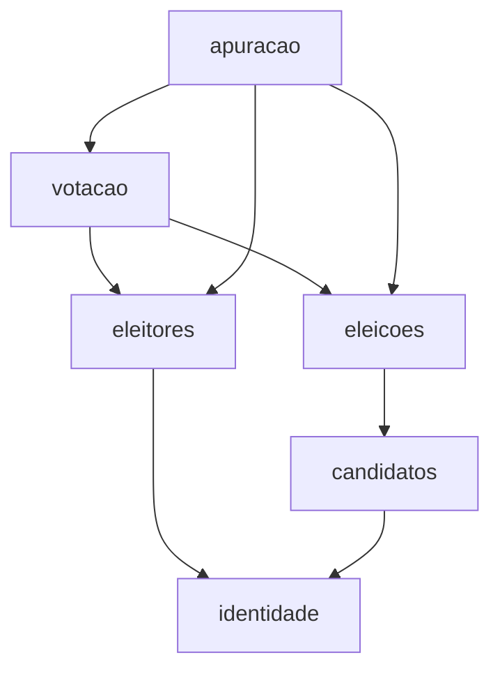
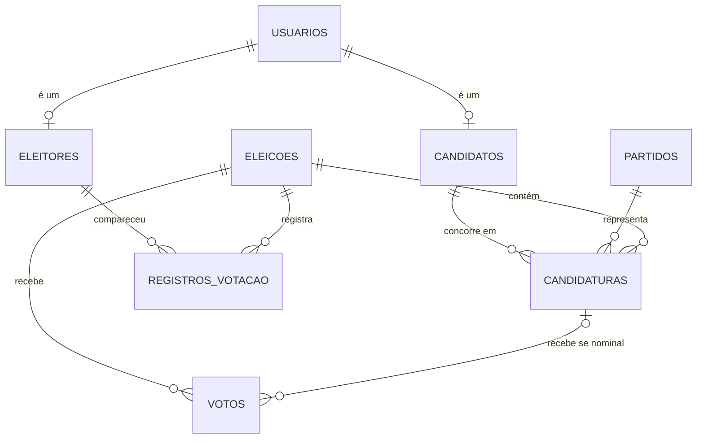

# API de Simulação de Eleição Eletrônica

[](https://github.com/marcoslacaille/trab-es2/actions/workflows/ci.yml)

## 1. Visão geral

Backend do **Sistema de Simulação de Eleição Eletrônica**, trabalho da disciplina de Engenharia de Software II (Prof. Marcelo Soares Loutfi, UNIRIO). É uma API REST em Python + FastAPI + PostgreSQL, organizada como **monólito modular**, que simula uma eleição de uma seção com três perfis: **Chefe da Seção** (cadastra eleitores, candidatos, partidos e eleições; abre e encerra a votação), **Eleitor** (consulta a cédula, registra e confirma o voto, acompanha a votação) e **Candidato** (acompanha a votação do cargo que disputa). O voto é secreto por construção: o banco nunca liga quem votou ao que foi votado.

Integrantes: Marcos Lacaille e demais membros do grupo (completar antes da entrega).

## 2. Links

- Repositório: https://github.com/marcoslacaille/trab-es2
- Documentação da API: [`docs/openapi.json`](docs/openapi.json) (OpenAPI 3.1) e [`docs/index.html`](docs/index.html) (Swagger UI estático). A publicação no GitHub Pages fica para depois, porque o repositório é privado (D-114); enquanto isso, use o Swagger local.
- Swagger local (com a API no ar): http://localhost:8000/docs (ReDoc em http://localhost:8000/redoc)
- Documentos de apoio: [`docs/ARQUITETURA.md`](docs/ARQUITETURA.md), [`docs/MODELAGEM.md`](docs/MODELAGEM.md), [`docs/DEMO.md`](docs/DEMO.md) (roteiro da apresentação), [`docs/PLANO.md`](docs/PLANO.md) (especificação) e [`docs/DECISOES.md`](docs/DECISOES.md) (decisões fora do plano).
- Coleção do Postman: [`docs/colecao-postman.json`](docs/colecao-postman.json) e ambiente [`docs/ambiente-postman.json`](docs/ambiente-postman.json).

### Documentação da API

A API é documentada pelo próprio código (OpenAPI 3.1, *code-first*). A especificação completa, com descrições, regras (RN-xx), exemplos e erros de cada rota, está em [`docs/openapi.json`](docs/openapi.json); dá para importá-la no Postman ou no Insomnia.

- **Autenticação:** `POST /api/v1/auth/login` (formulário com `username` = CPF e `password` = senha) devolve um token JWT. Envie-o em `Authorization: Bearer <token>`; no Swagger, use o botão *Authorize*.
- **Fluxo do voto (Eleitor):** consultar a cédula → registrar o voto (recebe `token_cedula`, válido por 5 minutos) → confirmar com o token. Cada cargo é votado separadamente.
- **Erros:** todas as rotas respondem `{"erro": {"codigo", "mensagem", "detalhes"}}`. 401 = não autenticado, 403 = perfil sem permissão, 404 = não encontrado, 409 = conflito com regra de negócio, 422 = dados inválidos.
- Depois de mudar rotas ou esquemas, regenere a especificação com `python -m app.scripts.exportar_openapi` (o teste TA-03 falha se ela ficar desatualizada) e atualize as tabelas abaixo (copiadas dela).

#### Rotas

##### Sistema

| Método | Caminho | Quem acessa | O que faz | Sucesso | Erros |
| --- | --- | --- | --- | --- | --- |
| `GET` | `/health` | Público | Verifica se a API e o banco estão no ar | 200 | — |

##### Autenticação

| Método | Caminho | Quem acessa | O que faz | Sucesso | Erros |
| --- | --- | --- | --- | --- | --- |
| `POST` | `/api/v1/auth/login` | Público | Entra no sistema com CPF e senha | 200 | 401, 422 |
| `GET` | `/api/v1/auth/me` | Qualquer logado | Consulta o usuário logado | 200 | 401 |

##### Eleições

| Método | Caminho | Quem acessa | O que faz | Sucesso | Erros |
| --- | --- | --- | --- | --- | --- |
| `POST` | `/api/v1/eleicoes` | Chefe | Cria uma eleição | 201 | 401, 403, 409, 422 |
| `GET` | `/api/v1/eleicoes` | Qualquer logado | Lista as eleições | 200 | 401, 422 |
| `GET` | `/api/v1/eleicoes/{eleicao_id}` | Qualquer logado | Consulta uma eleição | 200 | 401, 404, 422 |
| `PATCH` | `/api/v1/eleicoes/{eleicao_id}` | Chefe | Altera uma eleição | 200 | 401, 403, 404, 409, 422 |
| `POST` | `/api/v1/eleicoes/{eleicao_id}/abertura` | Chefe | Abre a votação | 200 | 401, 403, 404, 409, 422 |
| `POST` | `/api/v1/eleicoes/{eleicao_id}/encerramento` | Chefe | Encerra a votação | 200 | 401, 403, 404, 409, 422 |

##### Candidaturas

| Método | Caminho | Quem acessa | O que faz | Sucesso | Erros |
| --- | --- | --- | --- | --- | --- |
| `GET` | `/api/v1/eleicoes/{eleicao_id}/candidaturas` | Chefe | Lista as candidaturas da eleição | 200 | 401, 403, 404, 422 |
| `POST` | `/api/v1/eleicoes/{eleicao_id}/candidaturas` | Chefe | Cria uma candidatura | 201 | 401, 403, 404, 409, 422 |
| `PATCH` | `/api/v1/eleicoes/{eleicao_id}/candidaturas/{candidatura_id}` | Chefe | Altera uma candidatura | 200 | 401, 403, 404, 409, 422 |
| `DELETE` | `/api/v1/eleicoes/{eleicao_id}/candidaturas/{candidatura_id}` | Chefe | Remove uma candidatura | 204 | 401, 403, 404, 409, 422 |
| `GET` | `/api/v1/candidaturas/minhas` | Candidato | Lista as candidaturas do candidato logado | 200 | 401, 403 |

##### Eleitores

| Método | Caminho | Quem acessa | O que faz | Sucesso | Erros |
| --- | --- | --- | --- | --- | --- |
| `POST` | `/api/v1/eleitores` | Chefe | Cadastra um eleitor | 201 | 401, 403, 409, 422 |
| `GET` | `/api/v1/eleitores` | Chefe | Lista os eleitores | 200 | 401, 403, 422 |
| `GET` | `/api/v1/eleitores/eu` | Eleitor | Consulta os próprios dados de eleitor | 200 | 401, 403, 404 |
| `GET` | `/api/v1/eleitores/{eleitor_id}` | Chefe | Consulta um eleitor | 200 | 401, 403, 404, 422 |
| `PATCH` | `/api/v1/eleitores/{eleitor_id}` | Chefe | Altera um eleitor | 200 | 401, 403, 404, 422 |
| `DELETE` | `/api/v1/eleitores/{eleitor_id}` | Chefe | Exclui um eleitor | 204 | 401, 403, 404, 409, 422 |

##### Candidatos

| Método | Caminho | Quem acessa | O que faz | Sucesso | Erros |
| --- | --- | --- | --- | --- | --- |
| `POST` | `/api/v1/candidatos` | Chefe | Cadastra um candidato | 201 | 401, 403, 409, 422 |
| `GET` | `/api/v1/candidatos` | Chefe | Lista os candidatos | 200 | 401, 403, 422 |
| `GET` | `/api/v1/candidatos/eu` | Candidato | Consulta os próprios dados de candidato | 200 | 401, 403, 404 |
| `GET` | `/api/v1/candidatos/{candidato_id}` | Chefe | Consulta um candidato | 200 | 401, 403, 404, 422 |
| `PATCH` | `/api/v1/candidatos/{candidato_id}` | Chefe | Altera um candidato | 200 | 401, 403, 404, 422 |
| `DELETE` | `/api/v1/candidatos/{candidato_id}` | Chefe | Exclui um candidato | 204 | 401, 403, 404, 409, 422 |

##### Partidos

| Método | Caminho | Quem acessa | O que faz | Sucesso | Erros |
| --- | --- | --- | --- | --- | --- |
| `GET` | `/api/v1/partidos` | Qualquer logado | Lista os partidos | 200 | 401 |
| `POST` | `/api/v1/partidos` | Chefe | Cadastra um partido | 201 | 401, 403, 409, 422 |

##### Votação

| Método | Caminho | Quem acessa | O que faz | Sucesso | Erros |
| --- | --- | --- | --- | --- | --- |
| `GET` | `/api/v1/votacao/eleicoes/{eleicao_id}/cedula` | Eleitor | Consulta a cédula | 200 | 401, 403, 404, 409, 422 |
| `POST` | `/api/v1/votacao/eleicoes/{eleicao_id}/votos/registro` | Eleitor | Registra o voto (etapa 1) | 200 | 401, 403, 404, 409, 422 |
| `POST` | `/api/v1/votacao/eleicoes/{eleicao_id}/votos/confirmacao` | Eleitor | Confirma o voto (etapa 2) | 201 | 401, 403, 404, 409, 422 |
| `GET` | `/api/v1/votacao/eleicoes/{eleicao_id}/participacao` | Eleitor | Consulta em quais cargos já votou | 200 | 401, 403, 404, 422 |

##### Apuração

| Método | Caminho | Quem acessa | O que faz | Sucesso | Erros |
| --- | --- | --- | --- | --- | --- |
| `GET` | `/api/v1/apuracao/eleicoes/{eleicao_id}/parcial` | Qualquer logado | Acompanha a apuração parcial | 200 | 401, 403, 404, 409, 422 |
| `GET` | `/api/v1/apuracao/eleicoes/{eleicao_id}/resultado` | Qualquer logado | Consulta o resultado final | 200 | 401, 404, 409, 422 |

## 3. Como rodar

Pré-requisitos: Python 3.12, Git e Docker (Docker Desktop aberto, no Windows e no macOS). Mesmos passos numa máquina limpa; o Docker sobe dois bancos PostgreSQL 16: o da aplicação (porta 5432) e o de testes (porta 5433).

### Windows (PowerShell)

```powershell
docker compose up -d                                  # sobe o banco (5432) e o banco de teste (5433)
py -3.12 -m venv .venv
.venv\Scripts\python.exe -m pip install -r requirements-dev.txt
copy .env.example .env                                # troque JWT_SEGREDO e as senhas fora da demonstração
.venv\Scripts\python.exe -m alembic upgrade head      # cria as tabelas
.venv\Scripts\python.exe -m app.scripts.seed_demo     # dados de demonstração (opcional; já cria o Chefe)
.venv\Scripts\python.exe -m uvicorn app.main:app --reload
```

### Linux / macOS

```bash
docker compose up -d                                  # sobe o banco (5432) e o banco de teste (5433)
python3.12 -m venv .venv
source .venv/bin/activate
pip install -r requirements-dev.txt
cp .env.example .env                                  # troque JWT_SEGREDO e as senhas fora da demonstração
alembic upgrade head                                  # cria as tabelas
python -m app.scripts.seed_demo                       # dados de demonstração (opcional; já cria o Chefe)
uvicorn app.main:app --reload
```

A API fica em http://localhost:8000, o Swagger em http://localhost:8000/docs e a verificação de saúde em http://localhost:8000/health.

- **Sem a demonstração:** em vez do `seed_demo`, rode `python -m app.scripts.criar_chefe` (usa `CHEFE_CPF`, `CHEFE_NOME` e `CHEFE_SENHA` do `.env`). Não existe rota para criar Chefe.
- **Dados de demonstração:** `seed_demo` cria o Chefe, 3 partidos, 6 eleitores, 10 candidatos e a eleição de hoje (00:00 às 23:59) com as 10 candidaturas, ainda AGENDADA, e imprime a tabela de logins. Se já houver dados, avisa e não altera nada. Chefe: CPF `291.417.776-38`, senha `Chefe@2026`; eleitores: `Eleitor@123`; candidatos: `Candidato@123` (senhas fixas, só para a demo).
- **Recomeçar do zero:** `docker compose down -v`, `docker compose up -d`, `alembic upgrade head`, `seed_demo`.
- **Demonstração no Postman:** importe `docs/colecao-postman.json` e `docs/ambiente-postman.json` e siga o [`docs/DEMO.md`](docs/DEMO.md).

## 4. Como testar

```bash
pytest                                  # todos os testes (os de integração usam o banco de teste, porta 5433)
pytest tests/unitarios -v               # rápidos, sem banco
pytest tests/integracao -q              # API + PostgreSQL de teste
pytest tests/arquitetura -q             # fronteiras entre módulos, rotas protegidas, OpenAPI atualizado
pytest --cov=app --cov-report=term-missing   # cobertura
ruff check .                            # lint
ruff format --check .                   # formatação
```

No Windows, use `.venv\Scripts\python.exe -m <comando>` no lugar de `<comando>` (ex.: `.venv\Scripts\python.exe -m pytest`). Os testes de integração precisam do `docker compose up -d` (banco de teste na porta 5433).

| Tipo | Pasta | O que verifica | Precisa de |
| --- | --- | --- | --- |
| Unitário | `tests/unitarios/` | Regras puras (`dominio.py`), cédula, relógio, validadores | Nada (sem banco, sem HTTP) |
| Integração | `tests/integracao/` | A API de ponta a ponta contra o PostgreSQL de teste: rotas, permissões, restrições e trigger do banco, concorrência, sigilo e o roteiro completo da demonstração (TI-74) | Banco de teste |
| Arquitetura | `tests/arquitetura/` | Fronteiras entre módulos (TA-01), todas as rotas protegidas e documentadas, `docs/openapi.json` atualizado (TA-03) | Nada |

São 507 testes. O CI do GitHub Actions roda lint, formatação e testes a cada push e Pull Request.

## 5. Arquitetura

O sistema é um **monólito modular organizado por domínio**: um único processo FastAPI e um único banco PostgreSQL, divididos em 6 módulos de domínio (`identidade`, `eleitores`, `candidatos`, `eleicoes`, `votacao`, `apuracao`) mais um módulo `compartilhado`. Cada módulo é dono das suas tabelas e só conversa com os outros pelas funções do `servico.py` deles. As dependências formam um grafo sem ciclos, verificado por um teste automático.



Todo módulo também pode usar `compartilhado` e `identidade.dependencias` (autenticação nas rotas).

**Camadas de cada módulo** (a mesma forma em todos): `rotas.py` (HTTP, sem regra de negócio) → `servico.py` (casos de uso, única porta de entrada, controla a transação) → `dominio.py` (regras puras, sem FastAPI nem SQLAlchemy) e `repositorio.py` (consultas, só nas tabelas do módulo) → `modelos.py` (tabelas ORM); `esquemas.py` tem os contratos de entrada e saída.

**Principais decisões** (todas, com as alternativas descartadas, em [`docs/ARQUITETURA.md`](docs/ARQUITETURA.md)):

- **D01, monólito modular:** o enunciado não exige distribuição; mantém as fronteiras dos *bounded contexts* sem o custo de rede, vários bancos e deploy dos microsserviços.
- **D05, voto em duas etapas:** o registro devolve uma cédula assinada (token) e só a confirmação grava; o banco nunca guarda eleitor e escolha juntos, nem por um segundo.
- **D06, sigilo:** duas tabelas sem ligação (`registros_votacao` diz quem votou em qual cargo; `votos` diz o quê, sem quem).
- **D09, candidaturas no agregado da Eleição:** a eleição é a raiz; toda mudança passa por ela, e a regra "só com eleição AGENDADA" fica num lugar só.

Fluxo do voto (diagrama de sequência em [`docs/ARQUITETURA.md`](docs/ARQUITETURA.md)): `POST .../votos/registro` → prévia + `token_cedula` (nada gravado) → `POST .../votos/confirmacao` → grava `registros_votacao` e `votos` na mesma transação.

## 6. Modularização

| Módulo | Responsabilidade | Tabelas que possui | Interface pública (`servico.py`) |
| --- | --- | --- | --- |
| `compartilhado` | Configuração, sessão do banco, erros, relógio, paginação, validadores, `Cargo` | nenhuma | utilitários |
| `identidade` | Credenciais, login, token de acesso, perfis | `usuarios` | `autenticar`, `criar_credencial`, `atualizar_credencial`, `remover_credencial`, `obter_usuario`, `obter_usuarios`, `listar_usuarios` e, em `dependencias.py`, `obter_usuario_atual`, `exige_perfil` |
| `eleitores` | Cadastro de eleitores | `eleitores` | `cadastrar_eleitor`, `listar_eleitores`, `obter_eleitor`, `atualizar_eleitor`, `excluir_eleitor`, `obter_eleitor_do_usuario`, `obter_eleitor_logado`, `contar_aptos` |
| `candidatos` | Cadastro de candidatos (pessoas) e partidos | `candidatos`, `partidos` | `cadastrar_candidato`, `listar_candidatos`, `obter_candidato`, `atualizar_candidato`, `excluir_candidato`, `obter_candidato_do_usuario`, `obter_candidato_logado`, `obter_resumos_de_candidatos`, `criar_partido`, `listar_partidos`, `obter_partido` |
| `eleicoes` | Eleição (raiz do agregado) e suas candidaturas | `eleicoes`, `candidaturas` | `criar_eleicao`, `editar_eleicao`, `abrir_eleicao`, `encerrar_eleicao`, `obter_eleicao`, `listar_eleicoes`, `criar_candidatura`, `editar_candidatura`, `remover_candidatura`, `listar_candidaturas`, `candidaturas_do_usuario`, `obter_eleicao_para_votacao`, `buscar_candidatura_por_numero` |
| `votacao` | Cédula, registro e confirmação do voto, sigilo | `registros_votacao`, `votos` | `obter_cedula`, `registrar_voto`, `confirmar_voto`, `obter_participacao`, `contar_votos`, `contar_comparecimento` |
| `apuracao` | Acompanhamento parcial e resultado final (somente leitura) | nenhuma | `apuracao_parcial`, `resultado_final` |

`apuracao` não tem tabelas de propósito: combina dados que outros módulos já possuem (contagens de `votacao`, candidaturas de `eleicoes`, eleitores aptos de `eleitores`), então nenhum módulo lê a tabela de outro.

**Regras de fronteira:**

1. Um módulo importa de outro **apenas** `app.<outro>.servico` (e `app.identidade.dependencias` nas rotas).
2. Serviços devolvem `dataclass`es do `dominio.py`, nunca objetos ORM.
3. Nenhum `import` forma ciclo; as arestas permitidas são as do diagrama.
4. `dominio.py` não importa `fastapi` nem `sqlalchemy`.
5. Exceções só na "raiz de composição": `app/main.py`, `app/registro_modelos.py`, `app/scripts/*` e `migrations/env.py`.

**O teste TA-01** (`tests/arquitetura/test_dependencias.py`) lê o código com `ast` e falha se algum `import` violar essas regras, se houver ciclo ou se um `dominio.py` importar framework ou banco. As fronteiras deixam de ser combinado e viram teste.

**Conceitos da disciplina no código:** *módulos profundos* (poucas funções públicas em cada `servico.py`, muita lógica escondida atrás delas); *ocultação de informação* (só `identidade` conhece bcrypt e JWT de acesso; só `votacao` conhece as tabelas de voto); *baixo acoplamento* (nenhum módulo toca tabela de outro); *bounded contexts* (cada módulo com vocabulário próprio; `Cargo` no núcleo compartilhado); *agregados* (`Eleicao` é a raiz; candidaturas só mudam por ela); *sem flags de controle* (`abrir_eleicao()` e `encerrar_eleicao()`, nunca `alterar_status(abrir=True)`).

## 7. Modelagem do banco

São 8 tabelas no PostgreSQL 16. Dicionário de dados completo, restrições e migrações em [`docs/MODELAGEM.md`](docs/MODELAGEM.md).



(O diagrama completo, com todas as colunas, está em [`docs/MODELAGEM.md`](docs/MODELAGEM.md).) Repare: não existe linha entre `REGISTROS_VOTACAO` e `VOTOS`. Isso é proposital.

| Tabela | O que guarda |
| --- | --- |
| `usuarios` | Credencial de quem faz login: CPF, nome, hash da senha e perfil |
| `eleitores` | Eleitor: título, nascimento e a data de cadastro (define quem é "apto") |
| `candidatos` | Candidato (a pessoa): nome de urna e nascimento (desempate por idade) |
| `partidos` | Sigla, nome e número de 2 dígitos |
| `eleicoes` | Eleição: data, turno, janela de horário, situação (AGENDADA, ABERTA, ENCERRADA) |
| `candidaturas` | Candidato + eleição + cargo + partido + número: é nela que se vota |
| `registros_votacao` | Fato "este eleitor já votou neste cargo nesta eleição"; não diz em quem |
| `votos` | A escolha (nominal, branco ou nulo), com UUID aleatório; não diz quem votou |

**Restrições mais importantes** (garantidas pelo banco mesmo que a aplicação tenha um bug):

- **Um voto por eleitor e cargo:** chave primária (`eleitor_id`, `eleicao_id`, `cargo`) de `registros_votacao`; vale inclusive com duas requisições simultâneas.
- **Uma eleição aberta por vez:** índice único parcial `uq_eleicoes_uma_aberta` (`WHERE status = 'ABERTA'`).
- **Voto coerente com a candidatura:** chave estrangeira composta (`candidatura_id`, `eleicao_id`, `cargo`) → `candidaturas`; um voto para Senador nunca aponta para uma candidatura a Presidente, nem de outra eleição.
- **Voto imutável:** trigger `BEFORE UPDATE OR DELETE` em `votos` e `registros_votacao`.
- **Número do candidato coerente com o cargo:** `ck_candidaturas_numero_por_cargo` (2, 3, 4 ou 5 dígitos conforme o cargo); número único por cargo na eleição.
- **Situação coerente com os carimbos de tempo:** `ck_eleicoes_status_coerente`.

**Sigilo:** `registros_votacao` (quem votou em qual cargo) e `votos` (o quê, sem quem) não têm nenhuma ligação entre si. O voto tem UUID aleatório, não tem horário nem id sequencial, a resposta da confirmação não devolve a escolha. Nenhuma rota nem log expõe a correlação.

## 8. Regras de negócio

O catálogo completo (58 regras RN-01 a RN-58, cada uma com onde é implementada, o erro e a origem) está em [`docs/PLANO.md`](docs/PLANO.md), seção 8. Cada RN é citada na docstring da função que a implementa e no teste que a verifica.

Destaque, **regras complementares definidas pelo grupo** (não estão no enunciado, tornam a simulação coerente com a eleição brasileira):

- Quantidade de dígitos do número por cargo: Presidente 2, Governador 2, Senador 3, Deputado Federal 4, Deputado Estadual 5.
- Eleitor com pelo menos 16 anos.
- Voto em branco e voto nulo (número inexistente vira nulo, como na urna).
- Empate no mais votado: vence o candidato mais idoso.
- Segundo turno: só Governador e Presidente, com exatamente 2 candidatos por cargo.
- Só vota quem foi cadastrado antes da abertura da eleição ("previamente cadastrado").

## 9. Segurança e sigilo

- Login por CPF e senha devolve um JWT (HS256) de 60 minutos; a cada requisição o usuário é recarregado do banco, então perfil e exclusão valem na hora. CPF inexistente e senha errada dão a mesma resposta e demoram parecido.
- Senhas só como hash bcrypt (mínimo 8 caracteres, máximo 72 bytes); nenhuma resposta ou log contém senha, hash ou conteúdo de voto.
- Cada usuário tem exatamente um perfil; não há autocadastro. Toda rota exige login (exceto `/auth/login`, `/health` e a documentação) e declara os perfis aceitos; um teste automático verifica.
- Esquemas de entrada com `extra="forbid"` (sem atribuição em massa), respostas sempre por esquema explícito, só consultas SQLAlchemy parametrizadas, limites de tamanho e paginação.
- A cédula é um token assinado com audiência própria: não serve como token de acesso, só vale para o eleitor que a pediu e expira em 5 minutos.
- Voto único e imutável garantido pelo banco (chave primária e trigger); trava compartilhada na eleição impede votar no instante em que o Chefe encerra.
- Segredos só no `.env` (fora do Git); o `.env.example` tem valores de exemplo e deve ser trocado fora da demonstração.

Detalhes e a tabela de ameaças em [`docs/ARQUITETURA.md`](docs/ARQUITETURA.md).

## 10. Limitações conhecidas

- **Sigilo no banco:** quem tiver acesso administrativo direto ao PostgreSQL ainda poderia tentar correlacionar a **ordem física** em que as linhas foram gravadas nas duas tabelas. A urna real embaralha o registro digital do voto; aqui isso está fora do escopo.
- **Poucos votos:** com pouquíssimos votos, a apuração parcial pode permitir deduzir escolhas (o mesmo acontece em qualquer seção real com um único eleitor).
- **Token não revogável:** o token de acesso não pode ser revogado antes de expirar (60 min); isso é mitigado porque o usuário é recarregado do banco a cada requisição.
- **HTTPS:** responsabilidade do ambiente onde a API for publicada.
- **Sem limite de tentativas de login** e sem recuperação de senha nem e-mail.
- **Escopo:** sem frontend (a demonstração é no Postman), uma única seção, sem regras de "eleito" (o enunciado pede o **mais votado**) e sem geração automática do 2º turno.
- **Documentação publicada:** o GitHub Pages não está ativo (repositório privado); a documentação da API está neste README e em `docs/openapi.json`.

## 11. Estrutura de pastas

```text
trab-es2/
├── app/
│   ├── main.py                  # raiz de composição: cria o app, inclui routers, tratadores de erro
│   ├── registro_modelos.py      # importa os modelos de todos os módulos (para o Alembic)
│   ├── compartilhado/           # config, banco, erros, relógio, paginação, validadores, openapi, Cargo
│   ├── identidade/              # modelos, repositorio, dominio, senhas, tokens, servico, dependencias, esquemas, rotas
│   ├── eleitores/               # modelos, repositorio, dominio, servico, esquemas, rotas
│   ├── candidatos/              # modelos, repositorio, dominio, servico, esquemas, rotas
│   ├── eleicoes/                # modelos, repositorio, dominio, servico, esquemas, rotas
│   ├── votacao/                 # modelos, repositorio, dominio, cedulas, servico, esquemas, rotas
│   ├── apuracao/                # dominio, servico, esquemas, rotas (sem tabelas)
│   └── scripts/
│       ├── criar_chefe.py       # cria o Chefe da Seção inicial
│       ├── seed_demo.py         # dados de demonstração
│       └── exportar_openapi.py  # regenera docs/openapi.json
├── migrations/                  # Alembic: env.py e versions/ (0001 a 0005)
├── tests/
│   ├── conftest.py
│   ├── auxiliares.py            # fábricas de dados e helpers de login
│   ├── unitarios/               # sem banco e sem HTTP
│   ├── integracao/              # API + PostgreSQL de teste
│   └── arquitetura/             # fronteiras, rotas protegidas, OpenAPI atualizado
├── docs/
│   ├── PLANO.md                 # especificação completa
│   ├── DECISOES.md              # decisões fora do plano
│   ├── ARQUITETURA.md
│   ├── MODELAGEM.md
│   ├── DEMO.md                  # roteiro da apresentação
│   ├── colecao-postman.json     # coleção do roteiro (Postman v2.1)
│   ├── ambiente-postman.json    # ambiente do Postman
│   ├── openapi.json             # especificação exportada
│   ├── index.html               # Swagger UI estático
│   └── prompts/                 # tarefas e progresso
├── .github/workflows/ci.yml
├── alembic.ini
├── docker-compose.yml
├── pyproject.toml
├── requirements.txt
├── requirements-dev.txt
├── .env.example
└── README.md
```

## 12. Versionamento

- **Commits:** Conventional Commits em português, `tipo(escopo): descrição no presente`, um assunto por commit. Tipos: `feat`, `fix`, `test`, `refactor`, `docs`, `chore`, `ci`.
- **Branches:** uma por tarefa (`feat/identidade`, `feat/votacao`, `docs/entrega`...), integradas na `main` por Pull Request com o CI verde; nunca push direto na `main` nem `--force`.
- **Tags:** uma por marco concluído (`v0.2.0` em diante); a entrega final é a `v1.0.0`.
- **CI:** GitHub Actions roda `ruff check`, `ruff format --check` e `pytest` (com PostgreSQL de teste) a cada push e Pull Request.
- **Registro de decisões:** tudo o que foi feito e não estava no plano está em [`docs/DECISOES.md`](docs/DECISOES.md).
