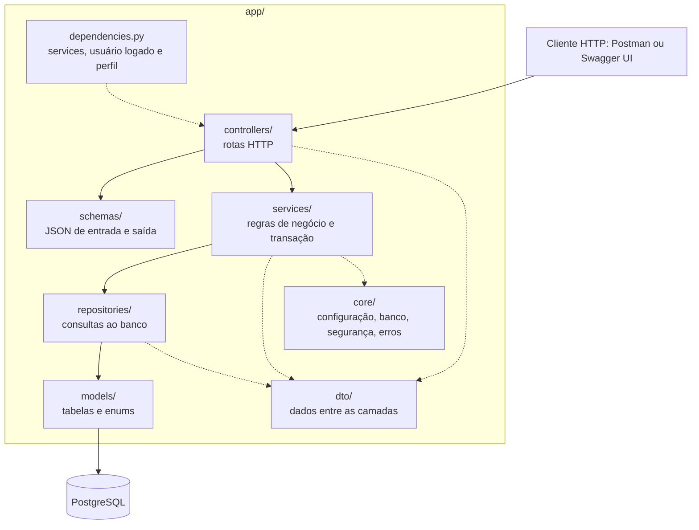
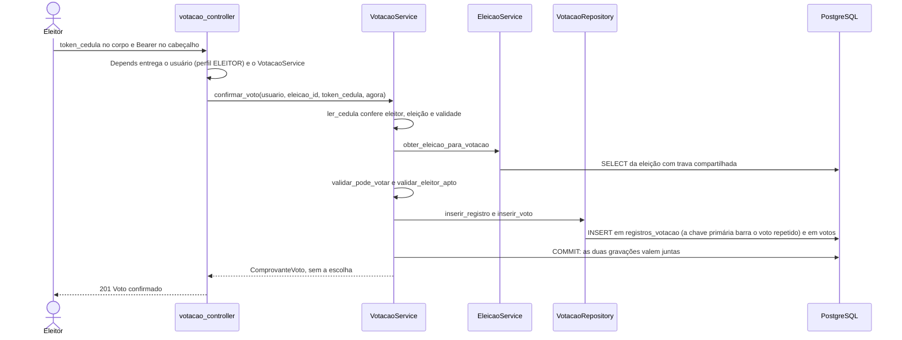
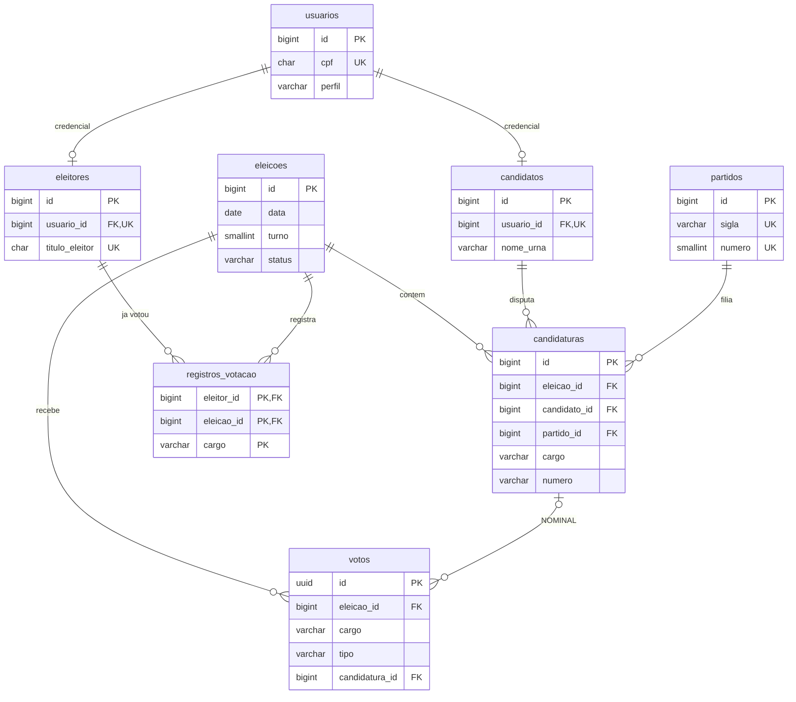

# API de Simulação de Eleição Eletrônica

[](https://github.com/marcoslacaille/trab-es2/actions/workflows/ci.yml)

> **Documentação da API (Swagger UI): <https://marcoslacaille.github.io/trab-es2/>**

| Entregável | Onde |
| --- | --- |
| Repositório | <https://github.com/marcoslacaille/trab-es2> |
| Documentação da API | [Swagger UI publicado](https://marcoslacaille.github.io/trab-es2/) (só para consulta), [`docs/openapi.json`](docs/openapi.json) e, com a API no ar, <http://localhost:8000/docs> |
| Arquitetura, modularização e banco | seções [4](#4-arquitetura), [5](#5-modularização) e [6](#6-modelagem-do-banco) deste README |
| Postman | [`docs/colecao-postman.json`](docs/colecao-postman.json) e [`docs/ambiente-postman.json`](docs/ambiente-postman.json) |

Trabalho de Engenharia de Software II, UNIRIO (Prof. Marcelo Soares Loutfi). Integrantes:

1. Marcos Lacaille
2. Pedro Bartkevihi
3. Guilherme Bretas

## 1. Visão geral

É o backend de uma simulação de eleição eletrônica de uma seção, em Python 3.12, FastAPI e SQLAlchemy 2 (síncrono), com PostgreSQL 16 e migrações do Alembic. Há três perfis: o **Chefe da Seção** cadastra eleitores, candidatos, partidos e eleições e abre e encerra a votação; o **Eleitor** consulta a cédula, registra e confirma o voto e acompanha a apuração; o **Candidato** acompanha a apuração do cargo que disputa. O voto é secreto: nenhuma tabela, rota, resposta ou log liga quem votou ao que foi votado. Quem acessa o banco diretamente ainda consegue correlacionar as duas tabelas; esse e os outros limites estão nas [limitações conhecidas](#8-limitações-conhecidas).

## 2. Como rodar

Pré-requisitos: Python 3.12, Git e Docker aberto. O `docker compose` sobe dois PostgreSQL 16: o da aplicação (porta 5432) e o dos testes (5433); com `--wait`, ele só devolve o terminal quando os dois aceitam conexões.

```powershell
copy .env.example .env                                # troque JWT_SEGREDO e as senhas fora da demonstração
docker compose up -d --wait
py -3.12 -m venv .venv
.venv\Scripts\python.exe -m pip install -r requirements-dev.txt
.venv\Scripts\python.exe -m alembic upgrade head      # cria as tabelas
.venv\Scripts\python.exe -m app.scripts.seed_demo     # Chefe e dados de demonstração (ou criar_chefe, abaixo)
.venv\Scripts\python.exe -m uvicorn app.main:app --reload --no-access-log
```

```bash
cp .env.example .env
docker compose up -d --wait
python3.12 -m venv .venv && source .venv/bin/activate
pip install -r requirements-dev.txt
alembic upgrade head
python -m app.scripts.seed_demo
uvicorn app.main:app --reload --no-access-log
```

A API fica em <http://localhost:8000>, com `/docs` e `/health`. Sem a demonstração, `python -m app.scripts.criar_chefe` cria só o Chefe, com `CHEFE_CPF`, `CHEFE_NOME` e `CHEFE_SENHA` do `.env`; não existe rota para criar Chefe. O `seed_demo` cria o Chefe, 3 partidos, 6 eleitores, 10 candidatos e a eleição de hoje (00:00 às 23:59), ainda AGENDADA, e grava tudo ou nada. Para recomeçar do zero: `docker compose down -v`, `docker compose up -d --wait`, `alembic upgrade head` e `seed_demo`.

## 3. Documentação da API

- **Publicada:** <https://marcoslacaille.github.io/trab-es2/> (`docs/index.html` lendo `docs/openapi.json`). É só para consulta: no GitHub Pages não há API, então a página não tem *Try it out* nem *Authorize*.
- **Local:** <http://localhost:8000/docs> (Swagger UI) e <http://localhost:8000/redoc>. Para as rotas protegidas, use *Authorize*: CPF em `username` e senha em `password`; o token fica salvo ao recarregar a página.
- **Como é gerada:** o FastAPI monta o OpenAPI 3.1 a partir dos controllers e dos schemas. Descrição, tags e parâmetros do Swagger ficam em `app/core/openapi.py`. O `python -m app.scripts.exportar_openapi` grava o `docs/openapi.json`, e o teste `test_especificacao_publicada_esta_atualizada` falha se ele ficar desatualizado.
- **Postman:** importe a coleção e o ambiente pelo arquivo ou por link ([coleção](https://raw.githubusercontent.com/marcoslacaille/trab-es2/main/docs/colecao-postman.json), [ambiente](https://raw.githubusercontent.com/marcoslacaille/trab-es2/main/docs/ambiente-postman.json)).
- **Rotas:** são 33 sob `/api/v1`, mais o `/health`. 24 vêm direto do enunciado; 9 são complementares: `GET /auth/me`, `GET /eleicoes`, `PATCH /eleicoes/{id}`, `PATCH` e `DELETE` de candidaturas, `/candidaturas/minhas`, `/eleitores/eu`, `/candidatos/eu` e a participação do eleitor na votação.

## 4. Arquitetura

Organizamos o backend em MVC com service, repository e DTO, uma pasta por camada. O Model são as tabelas (`models/`), a View é o JSON da API (`schemas/`) e o Controller são as rotas (`controllers/`). Entre eles, `services/` guarda as regras e a transação, `repositories/` guarda o SQL e `dto/` guarda os dados que passam de uma camada à outra.



O caminho de uma confirmação de voto, `POST /api/v1/votacao/eleicoes/{id}/votos/confirmacao`:



- **Injeção de dependência:** services e repositories são classes que recebem as dependências no construtor, com um padrão montado a partir da sessão. O `dependencies.py` entrega os services prontos aos controllers por `Depends` e resolve o usuário logado e o perfil exigido (`exige_perfil`). O repository nunca faz commit; a transação é do service.
- **`schemas` e `dto`:** os schemas são o JSON da API, em Pydantic. Os DTOs são dataclasses sem framework, e é por isso que `seed_demo` e `criar_chefe` usam os mesmos services sem passar pela API.
- **Regras de dependência:** controllers não importam repositories nem SQLAlchemy; services não importam FastAPI nem schemas, nem indiretamente (o que é do FastAPI e serve a todas as rotas, como o formato de erro, os tratadores e a paginação da URL, fica em `core/web.py`, que só os controllers e o `main.py` importam); DTOs e enums não importam framework; só o `UsuarioService` e o `dependencies.py` usam `core/security.py` (bcrypt e JWT), e só o `VotacaoService` usa `core/cedula.py`. O `tests/arquitetura/test_camadas.py` lê o código com `ast` e falha se alguma for quebrada.
- **Decisões:** monólito, sem rede entre módulos; SQLAlchemy síncrono, com rotas `def`; voto em duas etapas, com cédula cifrada (Fernet) que expira em 5 minutos e não grava nada; sigilo por desenho, com duas tabelas sem ligação; relógio injetável (`obter_agora`), para testar datas e horários; trava na eleição, de modo que não se vota no instante do encerramento; apuração lida num mesmo instante do banco (`REPEATABLE READ`).

## 5. Modularização

| Pasta de `app/` | Papel |
| --- | --- |
| `controllers/` | Rotas HTTP: recebem o JSON, chamam o service e devolvem a resposta |
| `services/` | Regras de negócio, validações e transação (commit e rollback) |
| `repositories/` | Consultas ao banco, sem commit |
| `schemas/` | JSON de entrada e saída (Pydantic), que alimenta o Swagger |
| `dto/` | Dataclasses que trafegam entre controller, service e repository |
| `models/` | Tabelas ORM, uma por arquivo, e os enums (`enums.py`) |
| `core/` | Configuração, banco, segurança, erros, OpenAPI, relógio, paginação, validadores, cédula e a parte web comum às rotas (`web.py`) |
| `scripts/` | `criar_chefe`, `seed_demo` e `exportar_openapi` |
| `main.py`, `dependencies.py` | Criação do app e entrega dos services, do usuário logado e do perfil |

Cada assunto atravessa as camadas com o mesmo nome (`<assunto>_<camada>.py`). A candidatura tem controller e schema próprios, mas usa o service e o repository da eleição, porque a eleição é a raiz do agregado.

| Assunto | Controller | Service | Repository | Tabelas |
| --- | --- | --- | --- | --- |
| Usuário e login | `auth` | `UsuarioService` | `UsuarioRepository` | `usuarios` |
| Eleitor | `eleitor` | `EleitorService` | `EleitorRepository` | `eleitores` |
| Candidato | `candidato` | `CandidatoService` | `CandidatoRepository` | `candidatos` |
| Partido | `partido` | `PartidoService` | `PartidoRepository` | `partidos` |
| Eleição e candidatura | `eleicao`, `candidatura` | `EleicaoService` | `EleicaoRepository` | `eleicoes`, `candidaturas` |
| Votação | `votacao` | `VotacaoService` | `VotacaoRepository` | `registros_votacao`, `votos` |
| Apuração | `apuracao` | `ApuracaoService` | (usa a votação) | nenhuma |

Entre os services, as dependências seguem um grafo sem ciclo: `Eleitor` e `Candidato` usam `Usuario`; `Eleicao` usa `Candidato` e `Partido`; `Votacao` usa `Eleicao` e `Eleitor`; `Apuracao` usa `Votacao`, `Eleicao` e `Eleitor`. Um service usa só o próprio repository e pede os dados de outro assunto ao service dele.

## 6. Modelagem do banco



São 8 tabelas. O diagrama mostra as chaves e as colunas que as regras citam; nomes, hash da senha e carimbos de tempo estão nos models e nas migrações. Todas as chaves estrangeiras são `ON DELETE RESTRICT`, e o nome de cada restrição segue a convenção `pk_`, `uq_`, `ck_`, `fk_`, que a aplicação usa para traduzir violações em erros de negócio.

| Tabela | Chaves, restrições e índices relevantes |
| --- | --- |
| `usuarios` | `cpf` único, com 11 dígitos; nome de pelo menos 3 caracteres; perfil entre os três; só o hash bcrypt da senha |
| `eleitores` | `usuario_id` e `titulo_eleitor` únicos; título com 12 dígitos; `criado_em` decide se o eleitor é apto (RN-53) |
| `candidatos` | `usuario_id` único; nome de urna e nascimento (desempate por idade) |
| `partidos` | `sigla`, `nome` e `numero` únicos; sigla de 2 a 10 letras ou dígitos; número de 10 a 99 |
| `eleicoes` | `(data, turno)` único; turno 1 ou 2; abertura antes do encerramento; `ck_eleicoes_status_coerente` liga o status aos carimbos; índice único parcial `uq_eleicoes_uma_aberta` |
| `candidaturas` | `(eleicao_id, cargo, numero)` e `(eleicao_id, candidato_id)` únicos; `(id, eleicao_id, cargo)` único (`uq_candidaturas_id_eleicao_id_cargo`), alvo da chave estrangeira composta de `votos`; `ck_candidaturas_numero_por_cargo`; `nome_urna` e `data_nascimento` gravados na abertura (migração `0006`), para que editar o candidato depois não mude a cédula nem o desempate de uma eleição já aberta |
| `registros_votacao` | chave primária `(eleitor_id, eleicao_id, cargo)`: impede voto duplo, mesmo com duas requisições simultâneas; índice `ix_registros_votacao_eleicao_id`, para o comparecimento |
| `votos` | `id` UUID aleatório; `tipo` NOMINAL, BRANCO ou NULO, e só o NOMINAL tem `candidatura_id` (`ck_votos_nominal_tem_candidatura`); chave estrangeira composta `(candidatura_id, eleicao_id, cargo)`, que impede um voto num candidato de outro cargo ou de outra eleição; índice `ix_votos_apuracao` |

**Banco e service.** O banco garante o voto único, o voto imutável e as referências entre as tabelas; quem decide se a eleição aceita voto naquele momento (status, janela de horário e eleitor apto) é o service.

**Sigilo.** `registros_votacao` diz quem já votou em cada cargo, e `votos` diz o que foi votado. Não há coluna nem chave que ligue uma à outra: o voto não tem eleitor, horário nem id sequencial. Um trigger `BEFORE UPDATE OR DELETE` nas duas tabelas (`impedir_alteracao_de_voto`) torna o voto confirmado imutável. Quem acessa o banco diretamente ainda consegue correlacionar as duas tabelas pelo `xmin` (veja as [limitações conhecidas](#8-limitações-conhecidas)).

**Migrações (Alembic, `migrations/versions/`):** `0001` usuários; `0002` eleitores; `0003` candidatos e partidos; `0004` eleições e candidaturas, com o índice parcial; `0005` registros de votação, votos e o trigger; `0006` o retrato do candidato na abertura.

## 7. Regras de negócio e perfis

A eleição segue um ciclo só de ida: `AGENDADA` → `ABERTA` → `ENCERRADA`. Os IDs `RN-xx` aparecem nas docstrings e nos testes.

| RN | Regra | Erro principal |
| --- | --- | --- |
| **Acesso e perfis** | | |
| RN-01 | Login por CPF e senha; qualquer falha devolve o mesmo 401 | `CREDENCIAIS_INVALIDAS` |
| RN-02 | Token de acesso de 60 min; o usuário é recarregado do banco a cada requisição | `TOKEN_INVALIDO` |
| RN-03 | Cada usuário tem um só perfil, e cada rota declara os perfis aceitos | `PERFIL_NAO_AUTORIZADO` |
| RN-04 | Sem autocadastro: o Chefe nasce por script; eleitores e candidatos, só pelo Chefe | |
| RN-05 | Senha de 8 caracteres a 72 bytes, guardada só como hash bcrypt | `SENHA_INVALIDA` |
| RN-06 | Toda rota exige login, exceto login, `/health` e a documentação | `NAO_AUTENTICADO` |
| RN-07 | CPF válido e único entre todos os usuários; aceita pontuação | `CPF_INVALIDO`, `CPF_JA_CADASTRADO` |
| RN-08 | Nome de 3 a 120 caracteres | `DADOS_INVALIDOS` |
| **Eleições** | | |
| RN-10 | Só o Chefe cria, edita, abre e encerra eleições | `PERFIL_NAO_AUTORIZADO` |
| RN-11 | Turno 1 ou 2, abertura antes do encerramento e data não anterior a hoje | `JANELA_INVALIDA`, `DATA_NO_PASSADO` |
| RN-12 | Uma eleição por data e turno | `ELEICAO_DUPLICADA` |
| RN-13 | Ciclo AGENDADA, ABERTA, ENCERRADA, sem pular etapa nem voltar | `TRANSICAO_INVALIDA` |
| RN-14 | Só a eleição AGENDADA pode ser editada | `ELEICAO_NAO_EDITAVEL` |
| RN-15 | Abrir exige o dia da eleição, o horário dentro da janela e ao menos uma candidatura | `FORA_DA_DATA`, `FORA_DA_JANELA`, `SEM_CANDIDATURAS` |
| RN-16 | Só uma eleição ABERTA por vez | `OUTRA_ELEICAO_ABERTA` |
| RN-17 | No 2º turno, abrir exige exatamente 2 candidaturas por cargo | `SEGUNDO_TURNO_INCOMPLETO` |
| RN-18 | Encerrar exige eleição ABERTA, a qualquer hora; depois disso nenhum voto entra | `TRANSICAO_INVALIDA` |
| RN-19 | Todo usuário consulta a eleição e recebe os `links` das ações do seu perfil | `ELEICAO_NAO_ENCONTRADA` |
| **Eleitores** | | |
| RN-20 | Só o Chefe cadastra, altera, consulta e exclui eleitores | `PERFIL_NAO_AUTORIZADO` |
| RN-21 | Título de eleitor com 12 dígitos, único | `TITULO_JA_CADASTRADO` |
| RN-22 | Idade mínima de 16 anos no cadastro | `IDADE_MINIMA` |
| RN-23 | CPF e título não mudam depois do cadastro | `DADOS_INVALIDOS` |
| RN-24 | Só se exclui eleitor que nunca votou | `EXCLUSAO_BLOQUEADA` |
| RN-25 | O eleitor consulta os próprios dados em `/eleitores/eu` | |
| **Candidatos, partidos e candidaturas** | | |
| RN-30 | Só o Chefe gerencia candidatos e cadastra partidos; todo usuário lista partidos | `PERFIL_NAO_AUTORIZADO` |
| RN-31 | Candidato com nome de urna de 3 a 30 caracteres e nascimento no passado | `DADOS_INVALIDOS` |
| RN-32 | Partido com sigla de 2 a 10 letras ou dígitos, nome e número de 10 a 99, os três únicos | `PARTIDO_DUPLICADO` |
| RN-33 | O CPF do candidato não muda depois do cadastro, e só se exclui candidato sem candidaturas | `DADOS_INVALIDOS`, `EXCLUSAO_BLOQUEADA` |
| RN-40 | Candidatura liga candidato, eleição, cargo, partido e número; só muda com a eleição AGENDADA | `ELEICAO_NAO_EDITAVEL` |
| RN-41 | O cargo é um dos cinco: deputado estadual, deputado federal, senador, governador, presidente | `DADOS_INVALIDOS` |
| RN-42 | Número com 2 dígitos para presidente e governador, 3 para senador, 4 para deputado federal e 5 para estadual | `NUMERO_INVALIDO_PARA_CARGO` |
| RN-43 | Número único por cargo na eleição | `NUMERO_JA_UTILIZADO` |
| RN-44 | Uma candidatura por candidato em cada eleição | `CANDIDATURA_DUPLICADA` |
| RN-45 | No 2º turno, só governador e presidente, com no máximo 2 por cargo | `CARGO_NAO_PERMITIDO_NO_TURNO` |
| RN-46 | Candidato e partido informados precisam existir | `REFERENCIA_INEXISTENTE` |
| RN-47 | O candidato consulta as próprias candidaturas em `/candidaturas/minhas` | |
| **Votação** | | |
| RN-50 | Só o perfil ELEITOR vota | `PERFIL_NAO_AUTORIZADO` |
| RN-51 | Só se vota em eleição ABERTA | `ELEICAO_NAO_ABERTA` |
| RN-52 | Passado o horário de encerramento, o voto é recusado mesmo sem o Chefe encerrar | `JANELA_ENCERRADA` |
| RN-53 | Só vota quem foi cadastrado antes da abertura | `ELEITOR_NAO_APTO` |
| RN-54 | Um voto por eleitor, por cargo, por eleição | `VOTO_JA_REGISTRADO` |
| RN-55 | Só se vota em cargo disputado | `CARGO_NAO_DISPUTADO` |
| RN-56 | Voto em duas etapas: registrar (nada é gravado) e confirmar (definitivo) | |
| RN-57 | A cédula expira em 5 minutos e só vale para o eleitor e a eleição de origem | `CEDULA_INVALIDA`, `CEDULA_EXPIRADA` |
| RN-58 | Número com candidatura é NOMINAL, sem candidatura é NULO; modo BRANCO é BRANCO | |
| RN-59 | Voto confirmado não se altera nem se exclui: sem rota e com trigger | |
| RN-60 | Sigilo: o banco nunca guarda eleitor e escolha juntos | |
| RN-61 | O eleitor consulta em quais cargos já votou, sem a escolha | |
| **Apuração** | | |
| RN-70 | Parcial só com eleição ABERTA; resultado final só com ENCERRADA | `APURACAO_INDISPONIVEL` |
| RN-71 | Eleitor e Chefe veem a parcial de todos os cargos | |
| RN-72 | O candidato vê só o cargo da sua candidatura | `CARGO_NAO_PERMITIDO` |
| RN-73 | O resultado final é visível para todos os perfis | |
| RN-74 | A contagem é calculada a cada consulta | |
| RN-75 | Todas as candidaturas do cargo, mesmo com 0 votos, por votos e depois por número | |
| RN-76 | Percentual sobre os votos válidos, com 2 casas; brancos e nulos à parte | |
| RN-77 | Mais votado = mais votos nominais; no empate vence o mais idoso, e persistindo, EMPATE | |
| RN-78 | Cargo sem votos válidos: sem mais votado e situação SEM_VOTOS_VALIDOS | |
| RN-79 | Comparecimento: aptos, votantes e abstenção | |

| Perfil | O que pode fazer |
| --- | --- |
| Chefe da Seção | Gerencia eleitores, candidatos, partidos, eleições e candidaturas; abre e encerra a votação; vê a apuração de todos os cargos |
| Eleitor | Consulta a cédula, registra e confirma o voto (um por cargo), vê em quais cargos votou e a apuração de todos os cargos |
| Candidato | Vê as próprias candidaturas e a apuração só do cargo que disputa; o resultado final é aberto a todos |

## 8. Limitações conhecidas

- **Sigilo no banco (transação):** quem votou e o voto são gravados na mesma transação, então as duas linhas têm o mesmo `xmin` (o ID da transação no PostgreSQL). Quem pode ler as duas tabelas liga cada voto ao eleitor com `JOIN ... ON v.xmin = r.xmin`, com precisão total. Por isso o acesso direto ao banco precisa ficar restrito; mudar o desenho (por exemplo, gravar os votos em lote e embaralhados) fica como melhoria futura.
- **Sigilo no banco (ordem física):** quem tiver acesso administrativo ao PostgreSQL também poderia tentar correlacionar a ordem em que as linhas foram gravadas nas duas tabelas. A urna real embaralha o registro digital do voto; aqui isso está fora do escopo.
- **Parcial exata:** a apuração parcial mostra os totais exatos a cada consulta. Quem consulta antes e depois de um único voto, e sabe quem votou nesse intervalo, deduz a escolha; o mesmo vale para um cargo com um único votante. Mostrar a parcial é exigência do enunciado; atualizar em lotes seria a mitigação.
- **Comparecimento recalculado:** a apuração é calculada a cada consulta, inclusive a de uma eleição já encerrada. Nome de urna e nascimento dos candidatos ficam congelados na abertura, então editar um candidato depois não muda o resultado; mas excluir um eleitor apto que não votou ainda reduz os aptos e a abstenção da eleição.
- **Token não revogável:** o token de acesso não pode ser revogado antes de expirar (60 min); isso é mitigado porque o usuário é recarregado do banco a cada requisição.
- **HTTPS:** responsabilidade do ambiente onde a API for publicada.
- **Sem limite de tentativas de login**, sem recuperação de senha e sem e-mail.
- **Escopo:** sem frontend (a demonstração é no Postman), uma única seção, sem regras de "eleito" (o enunciado pede o **mais votado**) e sem geração automática do 2º turno.

## 9. Testes

| Pasta | O que testa | Casos |
| --- | --- | ---: |
| `tests/unitarios/` | Regras dos services com repositories falsos, validadores, segurança, cédula e relógio; sem banco e sem HTTP | 97 |
| `tests/integracao/` | A API contra o PostgreSQL de teste: rotas, permissões, restrições e trigger, concorrência, sigilo e um roteiro completo | 92 |
| `tests/arquitetura/` | Regras de dependência entre as camadas (também pelos imports indiretos), rotas protegidas e `docs/openapi.json` atualizado | 25 |

```bash
pytest                                        # os 214 casos (precisa do docker compose up -d)
pytest tests/unitarios -q                     # rápidos
pytest --cov=app --cov-report=term-missing    # cobertura
```

No Windows, use `.venv\Scripts\python.exe -m pytest`. O banco de teste vem do `TEST_DATABASE_URL` do ambiente ou do `.env` (sem os dois, o do `docker compose`), e a suíte só aceita um banco cujo nome termine em `_teste`. A cobertura é de 99,4%. O CI roda `ruff check`, `ruff format --check` e `pytest` com PostgreSQL a cada push e Pull Request, e falha se a cobertura ficar abaixo de 96%.

## 10. Demonstração

Com o banco limpo, as migrações aplicadas, o `seed_demo` rodado e a API no ar, importe a coleção e o ambiente (*Eleição — local*) no Postman e rode as 23 requisições na ordem, uma a uma ou pelo Collection Runner. Rode o `seed_demo` no próprio dia da apresentação: a eleição dele é a de hoje, e a abertura (07) só funciona na data da eleição. Num banco limpo, o seed imprime `id 1`, que é o `eleicao_id` do ambiente; se imprimir outro, ajuste o ambiente. Entre registrar e confirmar um voto há 5 minutos, a validade da cédula. Logins do `seed_demo`:

| Perfil | CPF | Senha |
| --- | --- | --- |
| Chefe da Seção | `291.417.776-38` | `Chefe@2026` |
| Eleitores: Ana, Bruno | `011.524.493-03`, `341.672.110-17` | `Eleitor@123` |
| Candidato: Carlos Lima | `398.259.791-94` | `Candidato@123` |

1. **Perfis e cadastros (01 a 08):** login do Chefe, eleitor novo, CPF inválido (422), candidato novo, cadastro de uma eleição, consulta e abertura da eleição do seed, candidatura depois da abertura (409).
2. **Votação (09 a 17):** Ana consulta a cédula, registra e confirma Presidente 10; confirmar de novo dá 409; Bruno vota Presidente 20; o Chefe tenta votar e recebe 403.
3. **Acompanhamento (18 a 20):** Carlos Lima vê só a apuração do cargo dele; pedir outro cargo dá 403.
4. **Encerramento e resultado (21 a 23):** o Chefe encerra, votar depois dá 409 e o resultado final mostra os votos, os percentuais e o comparecimento. Em Presidente, Carlos Lima e Marina Costa empatam em 1 voto e vence o mais idoso (Carlos Lima, RN-77).

## 11. Versionamento

- A versão atual é a 2.0.0, organizada em camadas (MVC). As tags `v0.2.0` a `v1.0.0` marcam a organização anterior, por módulos.
- Conventional Commits em português, com um assunto por commit: `feat`, `fix`, `test`, `refactor`, `docs`, `chore`.
- O CI (GitHub Actions) roda lint, formatação e testes a cada push e Pull Request.
