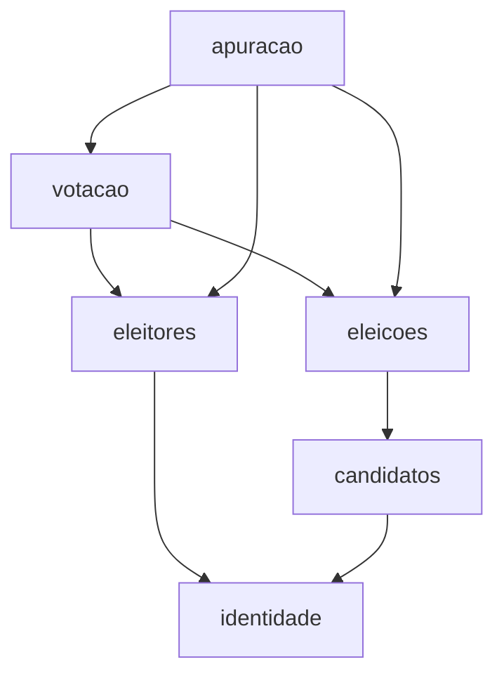
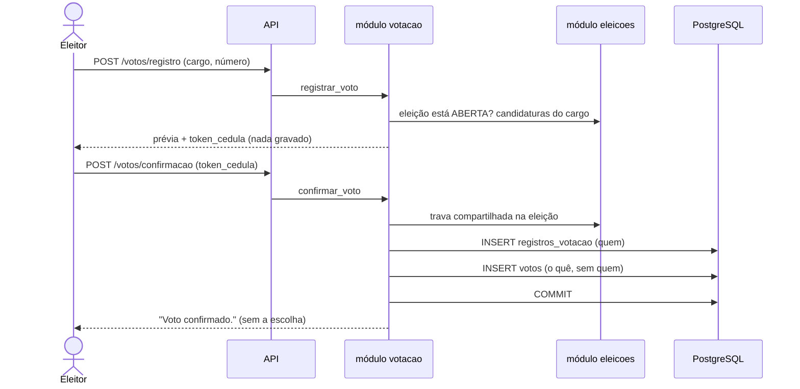

# Arquitetura

Este documento descreve a arquitetura do sistema como ela está no código (tag `v1.0.0`). O resumo para leitura rápida está no [`README.md`](../README.md); as regras de negócio (RN-xx) estão detalhadas em [`PLANO.md`](PLANO.md) e as escolhas que fizemos ao longo do desenvolvimento, em [`DECISOES.md`](DECISOES.md).

Conteúdo: decisões de projeto (seção 1), princípios de design (seção 2), módulos, camadas, fronteiras, transações e erros (seção 3), segurança (seção 4) e o fluxo do voto (seção 5).

## 1. Decisões de projeto

O sistema é uma API REST que simula uma eleição eletrônica com três perfis (Chefe da Seção, Eleitor e Candidato), organizada como **monólito modular** em Python + FastAPI + PostgreSQL, com testes unitários e de integração, histórico Git coerente e documentação Swagger. É o trabalho de back-end da disciplina de Engenharia de Software II (Prof. Marcelo Soares Loutfi), feito em grupo.

### Escopo: o que o sistema faz

1. Login de Chefe da Seção, Eleitor e Candidato, com funcionalidades separadas por perfil.
2. Chefe da Seção: cadastra, edita, abre, encerra e consulta eleições (data, turno, horários).
3. Chefe da Seção: CRUD de eleitores, CRUD de candidatos, cadastro de partidos e associação de candidato a eleição + cargo (candidatura).
4. Eleitor: consulta a cédula (candidatos por cargo), registra o voto e confirma o voto.
5. Eleitor acompanha a votação de todos os cargos; Candidato acompanha só o cargo que disputa.
6. Resultado final após o encerramento: votos por candidato e mais votado por cargo.
7. Tudo persistido em PostgreSQL: usuários, eleitores, candidatos, partidos, eleições, candidaturas, registros de votação e votos.

### Principais decisões

| # | Decisão | Escolha | Motivo | Alternativa descartada (e por quê) |
| --- | --- | --- | --- | --- |
| D01 | Arquitetura | Monólito modular organizado por domínio | O enunciado não exige distribuição, e um único processo tem menor complexidade operacional (aula 06); as fronteiras dos módulos são as de bounded contexts | Microsserviços (rede, vários bancos, deploy) e camadas técnicas globais (toda mudança atravessa todas as camadas) |
| D02 | Banco | PostgreSQL 16 | Restrições, transações, índice parcial e trigger garantem as regras críticas | SQLite (concorrência fraca), MongoDB (o problema é relacional) |
| D03 | Acesso a dados | SQLAlchemy 2.0 **síncrono** + Alembic; rotas `def` | Mais fácil de ler, testar e explicar; desempenho não é gargalo nessa escala | Async (event loop, `await` e sessões assíncronas sem ganho real aqui) |
| D04 | Perfis | Exatamente um perfil por usuário | O enunciado define três tipos de usuário | Vários papéis por usuário (RBAC mais complexo) |
| D05 | Fluxo do voto | Duas etapas: registro devolve uma **cédula cifrada** (token opaco, D-144); confirmação grava | O banco nunca guarda eleitor e escolha juntos, nem por um segundo | Rascunho de voto numa tabela (liga eleitor à escolha até a confirmação) |
| D06 | Sigilo | Duas tabelas sem ligação: `registros_votacao` (quem votou em qual cargo) e `votos` (o quê, sem quem); voto com UUID aleatório e sem horário | Nenhuma consulta pela API ou pelo modelo liga eleitor e voto (o limite para quem acessa o banco diretamente está em [`MODELAGEM.md`](MODELAGEM.md)) | Tabela única com `eleitor_id`; coluna "anônimo" |
| D07 | Apuração | Calculada a cada consulta (`GROUP BY`), numa transação `REPEATABLE READ` (D-146) | Sempre atualizada, sem estado duplicado | Contadores incrementais ou cache (risco de divergência) |
| D08 | Abertura e encerramento | Manuais, pelo Chefe; os horários definem a janela permitida | O enunciado diz que só o Chefe abre e encerra | Agendador automático (mais peças, difícil de demonstrar) |
| D09 | Candidaturas | Parte do agregado **Eleição** (a eleição é a raiz) | Toda mudança passa pela raiz (aula 07); a regra "só com eleição AGENDADA" fica num lugar só | Candidatura dentro do módulo de candidatos (cria dependência circular entre módulos) |
| D10 | Relógio | Função `agora()` injetável | Testes de data e horário determinísticos | `datetime.now()` espalhado pelo código |
| D11 | Idioma do código | Português | Linguagem ubíqua: o código usa as palavras do enunciado | Inglês (tradução mental o tempo todo) |
| D12 | Versionamento da API | Prefixo `/api/v1` | Boa prática de versionamento de APIs REST: uma mudança futura incompatível não quebra quem usa a versão atual | Sem versão |

### Regras complementares de realismo

O enunciado não pede estas regras. Nós as definimos para deixar a simulação coerente com a eleição brasileira, e por isso as chamamos de **regras complementares definidas pelo grupo**.

- Quantidade de dígitos do número por cargo: Presidente 2, Governador 2, Senador 3, Deputado Federal 4, Deputado Estadual 5.
- Eleitor com pelo menos 16 anos.
- Voto em branco e voto nulo (número inexistente vira nulo, como na urna).
- Empate no mais votado: vence o candidato mais idoso.
- Segundo turno: só Governador e Presidente, com exatamente 2 candidatos por cargo.
- Só vota quem foi cadastrado antes da abertura da eleição ("previamente cadastrado").
- Abertura só no dia da eleição e dentro da janela de horário cadastrada; passado o horário de encerramento, o voto é recusado mesmo que o Chefe ainda não tenha encerrado (RN-15, RN-52). Por isso, a eleição da demonstração é cadastrada para o próprio dia, com uma janela que cobre o horário da apresentação.
- Só uma eleição aberta por vez (RN-16).

### Fora do escopo

- Frontend: o enunciado pede apenas o back-end, e a demonstração é feita no Postman.
- Várias seções, zonas ou UFs: o sistema simula **uma** seção.
- Regras de "eleito" (maioria absoluta, quociente eleitoral): o enunciado pede o **mais votado**.
- Geração automática do 2º turno a partir do 1º.
- Recuperação de senha, e-mail, HTTPS (responsabilidade do ambiente de deploy) e limite de tentativas de login (não implementado).


## 2. Princípios de design

Escrevemos o código aplicando os conceitos da disciplina: Ousterhout (aulas 02 a 05), Newman e DDD (aulas 06 e 07). A tabela mostra cada princípio, a regra concreta que adotamos a partir dele e onde ela aparece no projeto.

| Princípio (aula) | Regra no código | Onde aparece |
| --- | --- | --- |
| Tolerância zero à complexidade (02) | Nomes que dizem o que a coisa é. Proibido: `temp`, `aux`, `data2`, `x`, `processa()`. | Todo o projeto |
| Programação estratégica (02) | Ao fim de cada módulo, uma rodada de refatoração antes do commit final (investimento contínuo de 10 a 20%). | Histórico do Git |
| Módulos profundos (03) | Cada módulo expõe poucas funções públicas em `service.py` e esconde muita lógica atrás delas. | `service.py` de cada módulo |
| Evitar classite (03) | Funções e `dataclass` simples. Nada de uma classe por operação, nem Interface + Implementação para tudo. | Todo o projeto |
| Interface formal e informal (03) | Assinaturas tipadas (formal) + docstring com regras de uso e RN (informal). | Funções públicas |
| Ocultação de informação (04) | Só `identidade` conhece bcrypt e JWT de acesso. Só `votacao` conhece as tabelas de voto. Os outros módulos chamam funções, não tabelas. | Fronteiras de módulo |
| `private` não é ocultação (04) | Nunca devolver o modelo ORM na API; sempre um esquema de resposta explícito. Nada de getter e setter que só expõem campos. | `schemas.py` |
| Sem flags de controle (04, 05) | Nenhuma função pública recebe booleano que muda o comportamento. `abrir_eleicao()` e `encerrar_eleicao()`, nunca `alterar_status(id, abrir=True)`. Escolhas viram enum (`ModoEscolha`). | `service.py` e `controller.py` |
| Sem decomposição temporal (04) | Organizar por responsabilidade (controller, service, domínio, repository), nunca por etapa ("passo1", "passo2"). | Estrutura de pastas |
| Baixo acoplamento (04, 06) | Nenhum módulo lê ou escreve tabela de outro (evita acoplamento de recurso comum e de conteúdo). Sem acoplamento de passagem: não repassar objetos que o módulo não usa. | Teste de arquitetura |
| Propósito geral (05) | Interfaces genéricas, implementações específicas. Um único `registrar_voto(cargo, modo, numero)` para todos os cargos; nunca `votar_presidente()`. | `votacao` |
| Especialização nas bordas (05) | `controller.py` e `schemas.py` são específicos do HTTP; o domínio no meio é genérico. | Camadas |
| Lei de Conway (06) | A divisão de módulos espelha a divisão de trabalho do grupo. | Divisão dos módulos entre os integrantes |
| Bounded contexts (07) | Cada módulo é um contexto com vocabulário próprio. `Cargo` vive no núcleo compartilhado (shared kernel). | `app/compartilhado/dominio.py` |
| Agregados (07) | `Eleicao` é raiz; candidaturas só mudam pela eleição (`/eleicoes/{id}/candidaturas`). Entre agregados, referência por ID. | `eleicoes` |
| Regra de dependência (07) | Dependências apontam para dentro: controller → service → domínio. `dominio.py` não importa FastAPI nem SQLAlchemy. | Teste de arquitetura |
| HATEOAS (07) | Respostas de eleição e de votação trazem `links` com as próximas ações possíveis. | `eleicoes`, `votacao` |
| Documentação como contrato (Swagger) | Code-first: a spec OpenAPI sai do código; toda rota documenta respostas de erro e tem exemplos reais. | `app/compartilhado/openapi.py`, `docs/openapi.json` |

### Regras de estilo

- Funções com no máximo \~40 linhas e no máximo 5 parâmetros; acima disso, agrupe em uma `dataclass`.
  - Exceção aceita (D-013): `identidade.service.criar_credencial(sessao, cpf, nome, senha, perfil, agora)` tem 6 parâmetros. A assinatura foi definida na especificação e é chamada pelos módulos `eleitores` e `candidatos`; uma `dataclass` só para isso seria classite.
- Tipagem em todas as assinaturas públicas.
- Docstring em toda função pública: o que faz, regras (RN-xx) e erros que pode levantar.
- Comentários explicam o **porquê**, não o quê.
- `ruff` como linter e formatador; zero avisos.


## 3. Módulos, camadas, fronteiras, transações e erros

Um único processo FastAPI e um único banco, divididos em **6 módulos de domínio** mais um módulo compartilhado. Cada módulo é dono das suas tabelas e só conversa com os outros pelas funções do `service.py` deles (e pelos tipos que essas funções recebem e devolvem). As dependências formam um grafo sem ciclos, verificado por um teste automático.

### Módulos e dependências



Todo módulo também pode usar `compartilhado`, `identidade.dependencias` (autenticação nas rotas) e os tipos `Perfil` e `UsuarioAutenticado` de `identidade.dominio` (D-103). Nenhuma outra dependência é permitida.

| Módulo | Responsabilidade (contexto) | Tabelas que possui | Interface pública (`service.py`) |
| --- | --- | --- | --- |
| `compartilhado` | Infraestrutura e núcleo compartilhado: configuração, sessão do banco, erros, relógio, paginação, validadores, `Cargo` | nenhuma | (utilitários) |
| `identidade` | Credenciais, login, token de acesso, perfis | `usuarios` | `autenticar`, `criar_credencial`, `atualizar_credencial`, `remover_credencial`, `obter_usuario`, `obter_usuarios`, `listar_usuarios` + `dependencias.py`: `obter_usuario_atual`, `exige_perfil` |
| `eleitores` | Cadastro de eleitores | `eleitores` | `cadastrar_eleitor`, `listar_eleitores`, `obter_eleitor`, `atualizar_eleitor`, `excluir_eleitor`, `obter_eleitor_do_usuario`, `obter_eleitor_logado`, `contar_aptos` |
| `candidatos` | Cadastro de candidatos (pessoas) e partidos | `candidatos`, `partidos` | `cadastrar_candidato`, `listar_candidatos`, `obter_candidato`, `atualizar_candidato`, `excluir_candidato`, `obter_candidato_do_usuario`, `obter_candidato_logado`, `obter_resumos_de_candidatos`, `criar_partido`, `listar_partidos`, `obter_partido` |
| `eleicoes` | Eleição (raiz do agregado) e suas candidaturas | `eleicoes`, `candidaturas` | `criar_eleicao`, `editar_eleicao`, `abrir_eleicao`, `encerrar_eleicao`, `obter_eleicao`, `listar_eleicoes`, `criar_candidatura`, `editar_candidatura`, `remover_candidatura`, `listar_candidaturas`, `candidaturas_do_usuario`, `obter_eleicao_para_votacao`, `buscar_candidatura_por_numero` |
| `votacao` | Cédula, registro e confirmação do voto, sigilo | `registros_votacao`, `votos` | `obter_cedula`, `registrar_voto`, `confirmar_voto`, `obter_participacao`, `contar_votos`, `contar_comparecimento` |
| `apuracao` | Acompanhamento parcial e resultado final (somente leitura) | nenhuma | `apuracao_parcial`, `resultado_final` |

Por que `apuracao` não tem tabelas: ela só combina dados que outros módulos já possuem (contagens de `votacao`, candidaturas de `eleicoes`, eleitores aptos de `eleitores`) e aplica as regras de apuração. Assim, nenhum módulo lê a tabela de outro (sem acoplamento de recurso comum).

### Camadas dentro de cada módulo

Todo módulo tem a mesma forma. Quem entende um entende todos. Os arquivos das camadas têm os nomes padrão (`controller`, `service`, `repository`, `model` e `schemas`); o resto do código segue em português (D11). A troca está registrada na D-154.

| Arquivo | Responsabilidade | Pode importar | Não pode importar |
| --- | --- | --- | --- |
| `controller.py` | HTTP: recebe a requisição, chama o `service` e devolve o esquema de resposta. Sem regra de negócio. | `schemas`, `service` do próprio módulo, `identidade.dependencias`, `compartilhado` | `repository`, `model` |
| `schemas.py` | Contratos Pydantic de entrada e saída, com exemplos para o Swagger | `dominio` do próprio módulo, `compartilhado` | SQLAlchemy |
| `service.py` | Casos de uso. Única porta de entrada do módulo para os outros. Controla a transação. | `dominio`, `repository` do próprio módulo, `service` e tipos do `dominio` dos módulos permitidos | `controller`, FastAPI |
| `dominio.py` | Regras puras: enums, `dataclass`es de retorno, funções de validação. Testável sem banco. | `compartilhado.dominio`, `compartilhado.validadores`, `compartilhado.erros`, tipos do `dominio` dos módulos permitidos (D-077, D-098) | FastAPI, SQLAlchemy, `repository`, `model` |
| `repository.py` | Consultas SQLAlchemy somente nas tabelas do módulo | `model` do próprio módulo | outros módulos |
| `model.py` | Tabelas ORM do módulo | `compartilhado.banco` | modelos de outros módulos (chave estrangeira por nome da tabela em texto: `ForeignKey("eleicoes.id")`) |

Arquivos extras por módulo: `identidade/senhas.py`, `identidade/tokens.py`, `identidade/dependencias.py`, `votacao/cedulas.py`.

### Regras de fronteira (o teste de arquitetura verifica)

1. Um módulo importa de outro **apenas** `app.<outro>.service` e, como contrato dessas funções, os tipos públicos (`dataclass`es e enums) do `dominio.py` dos módulos vizinhos no grafo (D-077, D-098). De `app.identidade.dominio`, todo `service.py` pode usar `Perfil` e `UsuarioAutenticado` (D-103); `app.identidade.dependencias`, só nas rotas.
2. Funções públicas do serviço devolvem `dataclass`es do `dominio.py`, **nunca** objetos ORM. O modelo do banco não vaza para fora do módulo.
3. Nenhum `import` forma ciclo entre módulos; as arestas permitidas são exatamente as do diagrama acima.
4. `dominio.py` não importa `fastapi`, `sqlalchemy`, `repository` nem `model`; `schemas.py` não importa `sqlalchemy`.
5. Exceções à regra 1, só na "raiz de composição": `app/main.py`, `app/registro_modelos.py`, `app/scripts/*` e `migrations/env.py`.

### Transações

- Cada requisição recebe uma sessão pela dependência `obter_sessao` (abre, entrega e fecha; fechar sem commit desfaz tudo).
- **Casos de uso chamados pelas rotas fazem `sessao.commit()` no final.** Funções públicas pensadas para outros módulos (`criar_credencial`, `remover_credencial` etc.) **não fazem commit**: quem chama controla a transação. A docstring diz isso.
- Exemplo: `cadastrar_eleitor` chama `identidade.criar_credencial` (sem commit), grava o eleitor e só então faz commit. Se algo falhar, nada fica gravado pela metade.
- Erro de integridade (`IntegrityError`) dentro de um caso de uso: `sessao.rollback()` e conversão para um erro de negócio com código (catálogo de erros na seção 10 do PLANO).

### Tratamento de erros

`app/compartilhado/erros.py` define uma hierarquia curta. O código do erro vai como argumento, para não criar uma classe por erro (evita classite):

```python
class ErroDeNegocio(Exception):
    status_http = 409

    def __init__(self, mensagem: str, codigo: str, detalhes: dict | None = None):
        super().__init__(mensagem)
        self.mensagem = mensagem
        self.codigo = codigo
        self.detalhes = detalhes or {}


class NaoAutenticado(ErroDeNegocio):
    status_http = 401


class AcessoNegado(ErroDeNegocio):
    status_http = 403


class NaoEncontrado(ErroDeNegocio):
    status_http = 404


class ConflitoDeEstado(ErroDeNegocio):
    status_http = 409


class DadosInvalidos(ErroDeNegocio):
    status_http = 422


# uso: raise ConflitoDeEstado("A eleição não está aberta.", codigo="ELEICAO_NAO_ABERTA")
```

Tratadores registrados no `main.py`:

1. `ErroDeNegocio` → `status_http` da classe + corpo `{"erro": {"codigo", "mensagem", "detalhes"}}`; em 401, cabeçalho `WWW-Authenticate: Bearer`.
2. `RequestValidationError` (Pydantic) → 422, código `DADOS_INVALIDOS`, `detalhes.campos` = lista de `{campo, mensagem}`.
3. `IntegrityError` não tratado → 409, código mapeado pelo nome da restrição (tabela em [`MODELAGEM.md`](MODELAGEM.md)) ou `CONFLITO_DE_DADOS`.
4. `HTTPException` do Starlette (os erros do próprio framework; a `HTTPException` do FastAPI é subclasse dela) → 404 `ROTA_NAO_ENCONTRADA` ("Rota não encontrada."), 405 `METODO_NAO_PERMITIDO` ("Método não permitido para esta rota.") e qualquer outro status `ERRO_HTTP` ("Erro na requisição."), sempre no mesmo corpo `{"erro": {...}}`. Os cabeçalhos que o framework mandou (como o `Allow` do 405) são mantidos.
5. `Exception` → 500, código `ERRO_INTERNO`, mensagem genérica; detalhes só no log, nunca na resposta.

## 4. Segurança

Login com CPF e senha devolve um token JWT de 60 minutos. A cada requisição o sistema valida o token **e recarrega o usuário do banco**: o token prova quem você é, mas o que você pode fazer vem do banco. Toda rota exige login, exceto `/auth/login`, `/health` e a documentação.

### Perfis

| Perfil | Valor | Como nasce |
| --- | --- | --- |
| Chefe da Seção | `CHEFE_SECAO` | Script `python -m app.scripts.criar_chefe`, com `CHEFE_CPF`, `CHEFE_NOME` e `CHEFE_SENHA` do `.env`. Idempotente: se o CPF já existe, não faz nada. Não existe rota para criar chefe. |
| Eleitor | `ELEITOR` | Cadastrado pelo Chefe (`POST /eleitores`). |
| Candidato | `CANDIDATO` | Cadastrado pelo Chefe (`POST /candidatos`). |

Não há autocadastro. Cada pessoa tem exatamente um perfil (decisão D04).

### Fluxo do login (`POST /api/v1/auth/login`)

1. Recebe um formulário OAuth2 (`application/x-www-form-urlencoded`): `username` = CPF (com ou sem pontuação), `password` = senha. Esse formato faz o botão **Authorize** do Swagger funcionar.
2. Normaliza o CPF (só dígitos, de 0 a 9). Se o formato for inválido, **não consulta o banco** e segue como se o usuário não existisse (não ajuda quem tenta adivinhar CPFs).
3. Se o formato for válido, busca o usuário pelo CPF.
4. Se não houver usuário (CPF mal formatado ou inexistente), **ainda assim** confere a senha contra um hash fictício, para a resposta levar o mesmo tempo, e responde 401 `CREDENCIAIS_INVALIDAS` ("CPF ou senha inválidos.").
5. Se a senha não conferir, o mesmo 401 com a mesma mensagem. Senha com mais de 72 bytes nunca confere (a comparação é feita mesmo assim, só para gastar o mesmo tempo).
6. Se conferir, gera o token e responde 200 com `access_token`, `token_type: "bearer"`, `expira_em` e `usuario` (`id`, `nome`, `perfil`).

### Token de acesso

| Campo (claim) | Valor |
| --- | --- |
| `sub` | ID do usuário, **como texto** (o PyJWT exige texto) |
| `perfil` | Perfil no momento do login (só informativo; a autorização usa o perfil do banco) |
| `aud` | `"eleicao-api:acesso"`. Impede que o token da cédula seja usado como token de acesso, e vice-versa. |
| `iat` / `exp` | Emissão e expiração (60 minutos), com o relógio real |
| Algoritmo | HS256 com `JWT_SEGREDO` (mínimo 32 caracteres). Na leitura, `algorithms=["HS256"]` é sempre explícito (bloqueia o truque do `alg: none`). |

`ler_token_acesso` devolve o ID do usuário. Qualquer falha vira 401 `TOKEN_INVALIDO`: assinatura, audiência ou expiração inválidas, claim obrigatório ausente e também um `sub` que não é número inteiro (`ValueError`).

### Senhas

- Mínimo de 8 caracteres e máximo de **72 bytes** em UTF-8 (limite do bcrypt; versões recentes recusam senhas maiores). Não pode ser só espaços. No login, `senha_confere` devolve falso para senha acima de 72 bytes (o bcrypt 5 levantaria `ValueError`, que viraria 500 e mudaria o tempo de resposta).
- Custo do bcrypt configurável: 12 em uso normal, 4 nos testes (senão os testes ficam lentos).
- Nenhuma resposta, log ou mensagem de erro contém senha ou hash.

### Proteções aplicadas em todo o projeto

- **Negar por padrão:** toda rota tem `obter_usuario_atual` ou `exige_perfil` (teste automático verifica; lista branca: `/auth/login`, `/health`, `/docs`, `/redoc`, `/openapi.json`).
- **Sem atribuição em massa:** todo esquema de entrada usa `model_config = ConfigDict(extra="forbid")`. Mandar `"perfil": "CHEFE_SECAO"` no cadastro de eleitor dá 422.
- **Respostas explícitas:** sempre `response_model`; nunca o modelo ORM; nunca `senha_hash`.
- **SQL injection:** só consultas SQLAlchemy com parâmetros; proibido montar SQL com f-string. O único SQL cru é o das migrações.
- **Limites de tamanho:** todo campo texto tem `max_length`; paginação com `tamanho` máximo 100.
- **Erros sem vazamento:** o erro 500 devolve mensagem genérica; o detalhe vai só para o log.
- **Logs:** registram método, caminho, status e duração. Nunca registram corpo da requisição, token, senha ou conteúdo de voto.
- **CORS desligado:** não há frontend; nada de `allow_origins=["*"]`.
- **Segredos:** só em `.env` (fora do Git). O `.env.example` tem valores de exemplo, e o README avisa para trocá-los.

### Ameaças e como o sistema se defende

| Ameaça | Defesa | Onde |
| --- | --- | --- |
| Descobrir quais CPFs têm conta | Mesma mensagem e mesmo tempo de resposta para CPF inexistente e senha errada | Login |
| Usar token roubado indefinidamente | Expiração de 60 min; usuário excluído perde o acesso na hora (recarregado do banco) | `obter_usuario_atual` |
| Virar Chefe mandando `perfil` no corpo | `extra="forbid"` + perfil lido do banco | `schemas.py` e dependências |
| Votar duas vezes (inclusive em paralelo) | Chave primária de `registros_votacao` | Banco |
| Votar no instante em que o Chefe encerra | Trava compartilhada na linha da eleição durante a confirmação | `votacao.service.confirmar_voto` |
| Alterar ou apagar um voto | Não existe rota; trigger bloqueia `UPDATE` e `DELETE` no banco | API e banco |
| Descobrir em quem alguém votou | Tabelas sem ligação, UUID aleatório, sem horário, nenhuma rota expõe, logs sem voto, confirmação não devolve a escolha, cédula cifrada | Modelo, API, logs |
| Confirmar a cédula de outro eleitor | O `usuario_id` dentro da cédula precisa ser o usuário logado | `votacao.service.confirmar_voto` |
| Usar a cédula como token de acesso | Formatos e chaves diferentes: o token de acesso é um JWT; a cédula é cifrada com Fernet e chave própria (D-144) | `tokens`, `cedulas` |
| Forjar uma cédula | Cifra autenticada (Fernet: AES e HMAC) com chave derivada do segredo do servidor | `cedulas` |
| Ler em quem o eleitor votou pela cédula (tela, cache, cópia do token) | Cédula cifrada; resposta do registro com `Cache-Control: no-store` | `cedulas`, `votacao.controller` |
| SQL injection | ORM com parâmetros | Repositórios |
| Força bruta no login | Fora do escopo; extra opcional não implementado: limite de tentativas | — |

### Limitações assumidas

- O token não pode ser revogado antes de expirar; isso é mitigado porque o usuário é recarregado do banco a cada requisição.
- HTTPS é responsabilidade do ambiente onde a API for publicada.
- As limitações de sigilo descritas em [`MODELAGEM.md`](MODELAGEM.md).


## 5. Fluxo do voto

O voto acontece em duas etapas. O registro só devolve uma prévia e a **cédula cifrada** (`token_cedula`); a confirmação é que grava, e grava em duas tabelas sem ligação entre si.



Por que assim: o banco nunca guarda eleitor e escolha juntos, nem por um segundo (D05); a chave primária de `registros_votacao` impede o voto duplo mesmo com requisições simultâneas; o trigger impede `UPDATE` e `DELETE` de um voto confirmado. Detalhes do modelo em [`MODELAGEM.md`](MODELAGEM.md).
