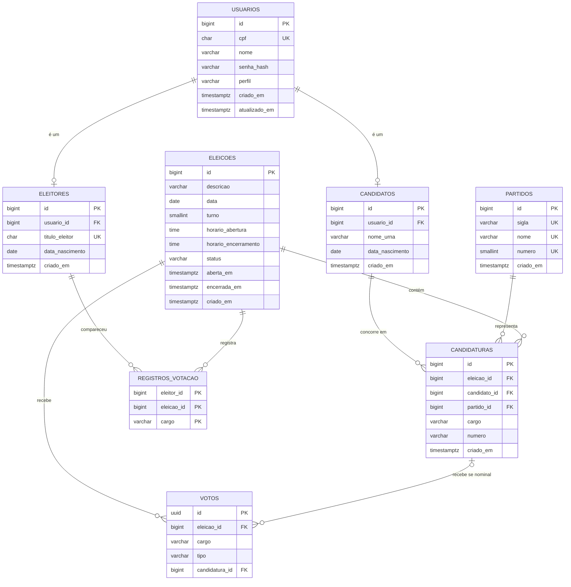

# Modelagem do banco de dados

Dicionário de dados, restrições, índices, trigger e política de exclusão do PostgreSQL 16. Foi conferido contra o banco criado pelas migrações (`alembic upgrade head`): colunas, tipos, restrições e índices abaixo são os que existem. A especificação original está em [`PLANO.md`](PLANO.md) (seção 6); a arquitetura em [`ARQUITETURA.md`](ARQUITETURA.md).

São 8 tabelas. As regras mais críticas são garantidas pelo próprio PostgreSQL, mesmo que a aplicação tenha um bug: um voto por eleitor e cargo (chave primária), uma eleição aberta por vez (índice parcial), voto coerente com a candidatura (chave estrangeira composta) e voto imutável (trigger). O ponto central do modelo é que **`registros_votacao` e `votos` não têm nenhuma ligação entre si**: é isso que garante o sigilo.

### Diagrama entidade-relacionamento



Repare: não existe linha entre `REGISTROS_VOTACAO` e `VOTOS`. Isso é proposital.

### Convenção de nomes das restrições (`app/compartilhado/banco.py`)

Toda restrição tem nome previsível. Assim a aplicação traduz uma violação do banco em um código de erro amigável.

```python
from sqlalchemy import MetaData
from sqlalchemy.orm import DeclarativeBase

CONVENCAO_DE_NOMES = {
    "ix": "ix_%(column_0_label)s",
    "uq": "uq_%(table_name)s_%(column_0_N_name)s",
    "ck": "ck_%(table_name)s_%(constraint_name)s",
    "fk": "fk_%(table_name)s_%(column_0_name)s_%(referred_table_name)s",
    "pk": "pk_%(table_name)s",
}


class Base(DeclarativeBase):
    metadata = MetaData(naming_convention=CONVENCAO_DE_NOMES)
```

### Tabelas

**`usuarios`** (módulo `identidade`): credencial de qualquer pessoa que faz login.

| Coluna | Tipo | Restrições |
| --- | --- | --- |
| id | BIGINT IDENTITY | PK |
| cpf | CHAR(11) | NOT NULL, `uq_usuarios_cpf`, `ck_usuarios_cpf_digitos`: `cpf ~ '^[0-9]{11}$'` |
| nome | VARCHAR(120) | NOT NULL, `ck_usuarios_nome_minimo`: `char_length(trim(nome)) >= 3` |
| senha_hash | VARCHAR(60) | NOT NULL (hash bcrypt; a senha nunca é gravada) |
| perfil | VARCHAR(20) | NOT NULL, `ck_usuarios_perfil_valido`: `perfil IN ('CHEFE_SECAO','ELEITOR','CANDIDATO')` |
| criado_em | TIMESTAMPTZ | NOT NULL |
| atualizado_em | TIMESTAMPTZ | NOT NULL |

**`eleitores`** (módulo `eleitores`)

| Coluna | Tipo | Restrições |
| --- | --- | --- |
| id | BIGINT IDENTITY | PK |
| usuario_id | BIGINT | NOT NULL, `uq_eleitores_usuario_id`, FK → `usuarios.id` ON DELETE RESTRICT |
| titulo_eleitor | CHAR(12) | NOT NULL, `uq_eleitores_titulo_eleitor`, `ck_eleitores_titulo_digitos`: `titulo_eleitor ~ '^[0-9]{12}$'` |
| data_nascimento | DATE | NOT NULL |
| criado_em | TIMESTAMPTZ | NOT NULL (usado para saber se o eleitor estava cadastrado antes da abertura) |

**`candidatos`** (módulo `candidatos`)

| Coluna | Tipo | Restrições |
| --- | --- | --- |
| id | BIGINT IDENTITY | PK |
| usuario_id | BIGINT | NOT NULL, `uq_candidatos_usuario_id`, FK → `usuarios.id` ON DELETE RESTRICT |
| nome_urna | VARCHAR(30) | NOT NULL |
| data_nascimento | DATE | NOT NULL (usada no desempate por idade) |
| criado_em | TIMESTAMPTZ | NOT NULL |

**`partidos`** (módulo `candidatos`)

| Coluna | Tipo | Restrições |
| --- | --- | --- |
| id | BIGINT IDENTITY | PK |
| sigla | VARCHAR(10) | NOT NULL, `uq_partidos_sigla`, `ck_partidos_sigla_formato`: `sigla ~ '^[A-Z0-9]{2,10}$'` |
| nome | VARCHAR(100) | NOT NULL, `uq_partidos_nome` |
| numero | SMALLINT | NOT NULL, `uq_partidos_numero`, `ck_partidos_numero_faixa`: `numero BETWEEN 10 AND 99` |
| criado_em | TIMESTAMPTZ | NOT NULL |

**`eleicoes`** (módulo `eleicoes`, raiz do agregado)

| Coluna | Tipo | Restrições |
| --- | --- | --- |
| id | BIGINT IDENTITY | PK |
| descricao | VARCHAR(120) | NOT NULL |
| data | DATE | NOT NULL |
| turno | SMALLINT | NOT NULL, `ck_eleicoes_turno_valido`: `turno IN (1, 2)` |
| horario_abertura | TIME | NOT NULL |
| horario_encerramento | TIME | NOT NULL, `ck_eleicoes_janela_valida`: `horario_abertura < horario_encerramento` |
| status | VARCHAR(10) | NOT NULL DEFAULT `'AGENDADA'`, `ck_eleicoes_status_valido`: `status IN ('AGENDADA','ABERTA','ENCERRADA')` |
| aberta_em | TIMESTAMPTZ | NULL até a abertura |
| encerrada_em | TIMESTAMPTZ | NULL até o encerramento |
| criado_em | TIMESTAMPTZ | NOT NULL |

Restrições da tabela:

- `uq_eleicoes_data_turno`: UNIQUE (`data`, `turno`). A seção não tem duas eleições no mesmo dia e turno.
- `ck_eleicoes_status_coerente`: o status combina com os carimbos de tempo.

```sql
(status = 'AGENDADA'  AND aberta_em IS NULL     AND encerrada_em IS NULL) OR
(status = 'ABERTA'    AND aberta_em IS NOT NULL AND encerrada_em IS NULL) OR
(status = 'ENCERRADA' AND aberta_em IS NOT NULL AND encerrada_em IS NOT NULL)
```

- `uq_eleicoes_uma_aberta`: índice único **parcial**, só uma eleição ABERTA por vez.

```python
Index("uq_eleicoes_uma_aberta", "status", unique=True, postgresql_where=text("status = 'ABERTA'"))
```

**`candidaturas`** (módulo `eleicoes`, entidade interna do agregado)

| Coluna | Tipo | Restrições |
| --- | --- | --- |
| id | BIGINT IDENTITY | PK |
| eleicao_id | BIGINT | NOT NULL, FK → `eleicoes.id` ON DELETE RESTRICT |
| candidato_id | BIGINT | NOT NULL, FK → `candidatos.id` ON DELETE RESTRICT |
| partido_id | BIGINT | NOT NULL, FK → `partidos.id` ON DELETE RESTRICT |
| cargo | VARCHAR(20) | NOT NULL, `ck_candidaturas_cargo_valido`: os 5 cargos |
| numero | VARCHAR(5) | NOT NULL, `ck_candidaturas_numero_por_cargo` (abaixo) |
| criado_em | TIMESTAMPTZ | NOT NULL |

- `uq_candidaturas_eleicao_id_cargo_numero`: número único por cargo na eleição (Presidente 13 e Governador 13 podem coexistir).
- `uq_candidaturas_eleicao_id_candidato_id`: um candidato tem no máximo uma candidatura por eleição.
- `uq_candidaturas_id_eleicao_id_cargo`: UNIQUE (`id`, `eleicao_id`, `cargo`), alvo da chave estrangeira composta de `votos`.
- `ck_candidaturas_numero_por_cargo`:

```sql
(cargo IN ('PRESIDENTE', 'GOVERNADOR') AND numero ~ '^[1-9][0-9]$') OR
(cargo = 'SENADOR'           AND numero ~ '^[1-9][0-9]{2}$') OR
(cargo = 'DEPUTADO_FEDERAL'  AND numero ~ '^[1-9][0-9]{3}$') OR
(cargo = 'DEPUTADO_ESTADUAL' AND numero ~ '^[1-9][0-9]{4}$')
```

**`registros_votacao`** (módulo `votacao`): quem já votou em qual cargo. Não diz em quem.

| Coluna | Tipo | Restrições |
| --- | --- | --- |
| eleitor_id | BIGINT | FK → `eleitores.id` ON DELETE RESTRICT |
| eleicao_id | BIGINT | FK → `eleicoes.id` ON DELETE RESTRICT; índice `ix_registros_votacao_eleicao_id` |
| cargo | VARCHAR(20) | `ck_registros_votacao_cargo_valido` |

- `pk_registros_votacao`: PRIMARY KEY (`eleitor_id`, `eleicao_id`, `cargo`). É **esta chave** que impede o voto duplo, inclusive com duas requisições chegando ao mesmo tempo.
- Sem coluna de horário e sem coluna de candidatura, de propósito.

**`votos`** (módulo `votacao`): o quê foi votado. Não diz quem votou.

| Coluna | Tipo | Restrições |
| --- | --- | --- |
| id | UUID | PK, gerado com `uuid.uuid4()` (aleatório, não revela a ordem) |
| eleicao_id | BIGINT | NOT NULL, FK → `eleicoes.id` ON DELETE RESTRICT |
| cargo | VARCHAR(20) | NOT NULL, `ck_votos_cargo_valido` |
| tipo | VARCHAR(10) | NOT NULL, `ck_votos_tipo_valido`: `tipo IN ('NOMINAL','BRANCO','NULO')` |
| candidatura_id | BIGINT | NULL (só preenchida no voto nominal) |

- `ck_votos_nominal_tem_candidatura`: `(tipo = 'NOMINAL') = (candidatura_id IS NOT NULL)`.
- `fk_votos_candidatura_id_candidaturas`: chave estrangeira **composta** (`candidatura_id`, `eleicao_id`, `cargo`) → `candidaturas` (`id`, `eleicao_id`, `cargo`). O banco garante que um voto para Senador nunca aponta para uma candidatura a Presidente, nem de outra eleição. Com `candidatura_id` nulo (branco ou nulo), a FK não é verificada (MATCH SIMPLE).
- `ix_votos_apuracao`: índice em (`eleicao_id`, `cargo`, `candidatura_id`) para a contagem.
- Sem `eleitor_id`, sem `criado_em`, sem id sequencial.

### Trigger: voto e registro são imutáveis

Criado na migração da votação com `op.execute(...)`. Mesmo um bug na aplicação (ou um `UPDATE` manual) não consegue alterar ou apagar um voto confirmado. Nos testes, a limpeza usa `TRUNCATE`, que não dispara triggers de linha.

```sql
CREATE FUNCTION impedir_alteracao_de_voto() RETURNS trigger AS $$
BEGIN
    RAISE EXCEPTION 'Votos e registros de votação confirmados são imutáveis';
END;
$$ LANGUAGE plpgsql;

CREATE TRIGGER trg_votos_imutaveis
    BEFORE UPDATE OR DELETE ON votos
    FOR EACH ROW EXECUTE FUNCTION impedir_alteracao_de_voto();

CREATE TRIGGER trg_registros_votacao_imutaveis
    BEFORE UPDATE OR DELETE ON registros_votacao
    FOR EACH ROW EXECUTE FUNCTION impedir_alteracao_de_voto();
```

O `downgrade` da migração remove os dois triggers e a função.

### Carimbos de tempo

Todos os `criado_em`, `atualizado_em`, `aberta_em` e `encerrada_em` são preenchidos **pelo serviço com o relógio injetável** (`agora`), não por `DEFAULT now()` do banco. Motivo: nos testes o relógio é congelado; se o banco usasse o horário real, a regra "eleitor cadastrado antes da abertura" daria resultados errados.

### Tradução de restrições em erros

O serviço verifica antes (mensagem clara) e o banco garante depois (corrida e bugs). Se a restrição disparar, `compartilhado/erros.py` traduz pelo nome dela (`exc.orig.diag.constraint_name`):

| Restrição | Código de erro | HTTP | Mensagem |
| --- | --- | --- | --- |
| `uq_usuarios_cpf` | `CPF_JA_CADASTRADO` | 409 | "Já existe um usuário com este CPF." |
| `uq_eleitores_titulo_eleitor` | `TITULO_JA_CADASTRADO` | 409 | "Já existe um eleitor com este título de eleitor." |
| `uq_partidos_sigla`, `uq_partidos_numero`, `uq_partidos_nome` | `PARTIDO_DUPLICADO` | 409 | "Já existe um partido com esta sigla, nome ou número." |
| `uq_eleicoes_data_turno` | `ELEICAO_DUPLICADA` | 409 | "Já existe uma eleição nesta data e turno." |
| `uq_eleicoes_uma_aberta` | `OUTRA_ELEICAO_ABERTA` | 409 | "Já existe outra eleição aberta." |
| `uq_candidaturas_eleicao_id_cargo_numero` | `NUMERO_JA_UTILIZADO` | 409 | "Este número já é usado por outra candidatura neste cargo." |
| `uq_candidaturas_eleicao_id_candidato_id` | `CANDIDATURA_DUPLICADA` | 409 | "Este candidato já tem candidatura nesta eleição." |
| `pk_registros_votacao` | `VOTO_JA_REGISTRADO` | 409 | "O eleitor já votou neste cargo nesta eleição." |
| `fk_registros_votacao_eleitor_id_eleitores` (ao excluir eleitor) | `EXCLUSAO_BLOQUEADA` | 409 | "Não é possível excluir: há registros que dependem deste." |
| `fk_candidaturas_candidato_id_candidatos` (ao excluir candidato) | `EXCLUSAO_BLOQUEADA` | 409 | "Não é possível excluir: há registros que dependem deste." |

Restrição que não está na tabela, ou que o driver não nomeia, vira `CONFLITO_DE_DADOS` (409, "Os dados enviados conflitam com os já gravados."). No código, cada linha é uma `TraducaoDeRestricao` (código, status e mensagem em português) em `ERROS_POR_RESTRICAO`.

### Política de exclusão

| Entidade | Pode excluir? | Como funciona |
| --- | --- | --- |
| Eleitor | Sim, se nunca votou | O serviço apaga o eleitor e depois a credencial. Se ele já votou, a FK de `registros_votacao` bloqueia → 409 `EXCLUSAO_BLOQUEADA`. |
| Candidato | Sim, se não tiver candidaturas | A FK de `candidaturas` bloqueia → 409. Remova as candidaturas antes (só com eleição AGENDADA). |
| Candidatura | Só com eleição AGENDADA | Regra no serviço de `eleicoes`. |
| Eleição e partido | Não há rota de exclusão | Eleições são histórico; partidos fora do escopo. |
| Voto e registro | Nunca | Trigger. |

### Migrações (Alembic)

Uma migração por módulo, em `migrations/versions/`. O banco de uma máquina limpa sai pronto com `alembic upgrade head`.

| Arquivo | Conteúdo |
| --- | --- |
| `0001_identidade` | `usuarios` |
| `0002_eleitores` | `eleitores` |
| `0003_candidatos_partidos` | `candidatos`, `partidos` |
| `0004_eleicoes_candidaturas` | `eleicoes` (com índice parcial), `candidaturas` |
| `0005_votacao` | `registros_votacao`, `votos`, função e triggers de imutabilidade |

As migrações foram escritas à mão a partir do autogenerate (que não cria trigger e pode errar o índice parcial) e testadas com `upgrade head` e `downgrade -1`. Para gerar uma nova: `python -m alembic revision --autogenerate --rev-id 0006 -m "descricao"` e revise o arquivo.

### Limitações conhecidas do sigilo

Quem tiver acesso administrativo direto ao banco ainda poderia tentar correlacionar a **ordem física** em que as linhas foram gravadas nas duas tabelas. A urna real resolve isso embaralhando o registro digital do voto. Aqui isso fica fora do escopo e é documentado como limitação. Outra: com pouquíssimos votos, a apuração parcial pode permitir deduzir escolhas (o mesmo acontece em qualquer seção real com um único eleitor).
